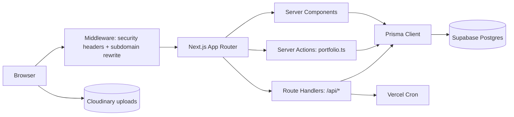
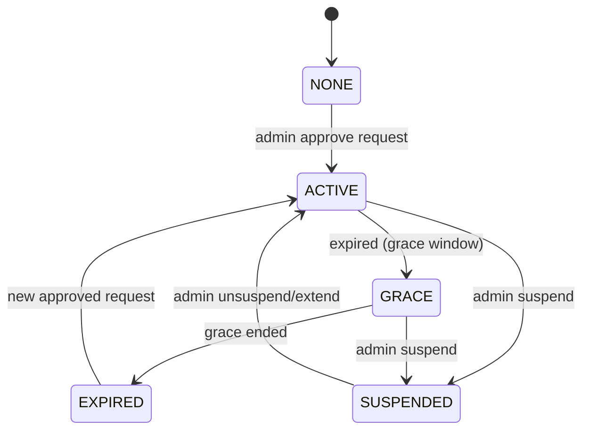

# Project Discovery & Technical Handoff

## 1. Project Overview

**Project name (package):** `marketos` (version 0.1.0, private). **Product name:** PortfolioHub Builder — a portfolio website builder SaaS.

**Primary purpose:** Let professionals (freelancers, designers, developers) create, edit, and publish a bilingual (Arabic/English) personal portfolio site — home page plus project pages — with themes, analytics, and paid subscription tiers. An admin back-office manages users, subscriptions, plans, payments, portfolios, notifications, settings, and audit logs.

**Problem solved:** Replaces hand-coded portfolios with a guided builder that produces a public, SEO-friendly, subscribable portfolio URL (subdomain rewrite to `/u/[username]`), with manual WhatsApp-based monetization and admin approval.

**Target audience:** End users (portfolio owners) + platform admins. Bilingual Arabic-first (RTL) with English support.

**Main features (verified in code):**
- Email/password auth with session cookies, email verification tokens, password reset/change, suspended/banned handling, must-change-password flow.
- Portfolio builder (split-pane editor): sections (hero, about, experience, skills, services, projects, testimonials, footer), themes, fonts, avatar upload, project pages with items, testimonials, services.
- Autosave (2s debounce) + optimistic concurrency + conflict modal (reload/overwrite), beforeunload guard.
- Publish/unpublish lifecycle with preconditions (username, hero name, visible section, subscription).
- Subscription tiers: plans, request flow with WhatsApp deep-link + 6-char code, admin approve/reject (transactional), grant/extend/suspend, lifecycle cron (reminders/grace/expiry), history, consumption limits.
- Public portfolio rendering (`/u/[username]`, project pages) with gating (PUBLISHED ∧ !adminHidden ∧ ACTIVE subscription), public DTO (no PII leak), SEO metadata, sitemap, robots.
- Analytics: page/project/whatsapp events, DailyVisit + VisitDedup dedupe, owner exclusion, dashboard (allTime/7d/30d/prev/project/whatsapp/daily/countries).
- Admin panel: dashboard counters, users (suspend/unsuspend/reset/revoke), portfolios (hide/unhide + reason), audit log, settings registry, requests/subscriptions/payments/plans CRUD.
- Notifications: DB-first per-recipient bilingual rows, dedupe keys, bell (badge, dropdown, polling), read/read-all, `/profile/notifications`.
- Landing page (`/`, `/en`) with hreflang, terms/privacy stubs, public plans API.
- Media uploads via Cloudinary (client-side unsigned preset) + MediaFile log.

**Core business logic:** Subscription state machine (NONE/ACTIVE/GRACE/EXPIRED/SUSPENDED) computed in `src/lib/subscriptions.ts` (`getSubscriptionState`, `canPublish`, `isPortfolioVisible`, `getEffectiveLimits`). Publish requires `canPublish` (ACTIVE‖GRACE) + plan limits (projects/sections/storage caps) + safety caps (30 sections/50 projects/60 items). Visibility gate in `src/lib/visibility.ts`. Optimistic concurrency via `UserProfile.version` (incremented on write; `expectedVersion` mismatch → 409). Rate limiting via DB-backed `RateLimitBucket` (login/register). Session tokens stored as SHA-256 hex.

**Value proposition:** A complete, bilingual, subscription-gated portfolio builder with admin back-office, derived from a proven MarketOS codebase, deployable to Vercel + Supabase.

**Current development stage:** Feature-complete through Sprint H of the gap-closure plan (~85% conformance ceiling). In-progress: keyboard-accessible reordering of experience items in the builder (uncommitted). Performance/security hardening items from the production-readiness audit remain open.

---

## 2. Technical Stack

| Layer | Technology | Version |
|---|---|---|
| Framework | Next.js (App Router) | 16.2.12 |
| UI | React / React DOM | 19.2.4 |
| Language | TypeScript | ^5 |
| Styling | Tailwind CSS | ^4 (via @tailwindcss/postcss) |
| ORM | Prisma | 5.22.0 (`@prisma/client`) |
| Database | PostgreSQL (Supabase) | pooled (port 6543) + direct (5432) |
| Auth crypto | bcryptjs | ^2.4.3 |
| JWT/session | jose | ^5.10.0 |
| Validation | zod | ^4.6.7 |
| DnD | @dnd-kit/core / sortable / utilities | ^6.3.1 / ^10.0.0 / ^3.2.2 |
| Icons | lucide-react | ^1.27.0 |
| Themes | next-themes | ^0.4.6 |
| Phone | libphonenumber-js | ^1.13.15 |
| Push (deferred) | firebase / firebase-admin | ^11.10.0 / ^13.10.0 |
| Supabase client | @supabase/supabase-js | ^2.117.3 |
| Testing | vitest | ^4.1.10 |
| E2E | @playwright/test | ^1.64.1 |
| Lint | eslint / eslint-config-next | ^9 / 16.2.12 |
| Runtime | Node | 24.x (engines) |
| Build runner | tsx | ^4.23.12 |

**Hosting/deployment:** Vercel (standalone output also configured for Docker parity). Supabase for Postgres. Cloudinary for media. Firebase for push (interface-ready, sending deferred). Resend email is a stub (`src/lib/resend/send.ts`).

**Build tools:** `npm run build` = `prisma generate && next build`. `npm run dev` = `next dev --webpack`. `npm run lint`, `npm run typecheck`, `npm run test` (vitest run). Playwright config at root.

---

## 3. Project Architecture

**Overall:** Next.js App Router monolith. Server Components fetch via Prisma directly; mutations via Server Actions (`src/lib/actions/*`) and Route Handlers (`src/app/api/*`). No separate backend service.

**Frontend/backend communication:**
- Server Components read Prisma directly (e.g. `src/app/u/[username]/page.tsx`).
- Server Actions: `src/lib/actions/portfolio.ts` (getOrCreateProfile, updatePortfolio, publishProfile, unpublishProfile, create/update/delete project pages, analytics, username availability), `src/lib/actions/resend-verification.ts`, `src/lib/actions/builder-locale.ts`.
- Route Handlers: auth, me/*, admin/*, cron/*, portfolio/track, health, verify-email, public/plans, username-available, og.

**Application structure:**
- `src/app/` — routes (pages + API).
- `src/components/` — UI (portfolio templates, admin, landing, ui primitives).
- `src/lib/` — auth, guards, db, validations, actions, tasks.
- `src/hooks/`, `src/types/`.
- `prisma/` — schema + migrations.
- `supabase/migrations/` — SQL migrations (0001–0006).
- `e2e/`, `__tests__/`.

**Main modules & responsibilities:**
- `src/lib/auth.ts` — login/register/logout/session creation, bcrypt, rate-limit hooks, enumeration-resistant errors.
- `src/lib/guards.ts` — `requireUser`, `requireAdmin`, `requireAdminApi`.
- `src/lib/prisma.ts` — Prisma singleton (globalThis caching in dev).
- `src/lib/portfolio.ts` — username validation, helpers.
- `src/lib/portfolio-schema.ts` — Zod content schema (caps, link allowlist).
- `src/lib/subscriptions.ts` — state computation + limits.
- `src/lib/visibility.ts` — public gating.
- `src/lib/public-profile.ts` — public DTO mapping.
- `src/lib/visits.ts` — recordVisit (dedupe-gated).
- `src/lib/notify.ts` — notification creation.
- `src/lib/csrf.ts` — same-origin check.
- `src/lib/rate-limit.ts` — DB-backed buckets.
- `src/lib/env.ts` — Zod env validation.
- `src/lib/errors.ts` — unified error shape.
- `src/lib/pagination.ts`, `src/lib/audit.ts`, `src/lib/settings.ts`, `src/lib/cloudinary.ts`, `src/lib/whatsapp.ts`, `src/lib/phone.ts`, `src/lib/platform.ts`.

**Database architecture:** Relational Postgres. Core entities: User, Session, RateLimitBucket, Workspace*, Content*, Strategy*, Planning*, CalendarEvent, SwotCard, Task, Campaign, Lead, FcmToken, Notification, Media/MediaFile, Plan, Subscription, SubscriptionRequest, SubscriptionEvent, Payment, SystemSetting, AdminAuditLog, AdminUserNote, Referral, SharedLink, UserProfile, ProfilePage, PageSection, ProjectPage, ProjectItem, Testimonial, Service, PortfolioViewEvent, DailyVisit, VisitDedup, Announcement. (Workspace/content/strategy/planning/calendar/swot/task/campaign/lead/media models originate from MarketOS and remain in schema; the portfolio subset is UserProfile+.)

**API structure:** REST-ish route handlers under `src/app/api/*`. Auth routes: login/register/logout/me/change-password. Me: subscription, subscription/history, subscription-requests, plans, notifications (read/read-all/unread-count/[id]/read). Admin: users, portfolios, plans, subscriptions, subscription-requests, payments, settings, announcements, audit-log, dashboard, fcm-subscribe. Cron: cleanup, subscription-lifecycle. Public: plans, username-available, portfolio/track, health, verify-email, og.

**Auth flow:** Register → (email verification token created but email delivery stubbed) → session cookie (raw token in cookie, SHA-256 in DB). Login: find user by email, bcrypt compare, dummy-hash timing equalization, suspended check after password, rate limits (per-email + per-IP), session creation, lastLoginAt update. Cookie: httpOnly, SameSite=Lax, Secure in prod, 7-day expiry. Logout deletes session. Change-password kills other sessions. `mustChangePassword` → redirect `/change-password`.

**Authorization:** `isAdmin` flag on User. `requireAdminApi()` on all `/api/admin/**`. Admin mutations write `AdminAuditLog`. User-level ownership checks in actions.

**Third-party integrations:** Cloudinary (uploads, client-side unsigned preset — security note), Firebase (push, deferred), Supabase (DB + auth client present but auth is custom), Resend (stub), WhatsApp (deep links for subscription requests).

**Data flow (builder save):** BuilderClient → `updatePortfolio(profile, expectedVersion)` Server Action → Prisma transaction-ish writes (section updates, project upserts, deleteMany/createMany items) → version bump. Conflict → 409 + current version → modal.

**Mermaid — high-level:**



**Mermaid — subscription state:**



---

## 4. Folder & File Structure

Simplified tree (most important files):

```
PortholioHub-Builder-copy/
├── package.json, next.config.ts, tsconfig.json, playwright.config.ts, vitest.config.ts
├── prisma/
│   ├── schema.prisma
│   ├── seed.ts
│   └── migrations/ (20261022..., 20261023...)
├── supabase/migrations/ (0001_init … 0006_analytics)
├── src/
│   ├── middleware.ts
│   ├── routes.manifest.ts
│   ├── app/
│   │   ├── layout.tsx, page.tsx, en/page.tsx, error.tsx, not-found.tsx, loading.tsx
│   │   ├── sitemap.ts, robots.ts
│   │   ├── login/, register/, change-password/, terms/, privacy/
│   │   ├── profile/builder/ (page.tsx, BuilderClient.tsx, LivePreview, editors, i18n/, ui/)
│   │   ├── profile/builder/analytics/page.tsx
│   │   ├── profile/subscription/, profile/notifications/
│   │   ├── u/[username]/page.tsx, u/[username]/projects/[slug]/
│   │   ├── admin/ (layout, dashboard, users, portfolios, plans, subscriptions, payments, requests, settings, announcements, audit-log, support, revenue)
│   │   ├── api/ (auth, me, admin, cron, health, portfolio/track, public, username-available, verify-email, og)
│   │   └── og/route.tsx
│   ├── components/
│   │   ├── portfolio/ (ClassicTemplate, ProjectPageView, TestimonialsSlider, TrackBeacon, analytics/*)
│   │   ├── admin/ (DataTable, AdminSidebar, actions, forms)
│   │   ├── landing/ (LandingPage, LandingHeader)
│   │   ├── ui/ (Button, Input, Toast, Card, Skeleton, EmptyState, ErrorBoundary)
│   │   └── auth/, home/, notifications/
│   ├── lib/ (auth, guards, prisma, env, errors, csrf, rate-limit, subscriptions, visibility, public-profile, visits, notify, audit, settings, cloudinary, whatsapp, phone, platform, portfolio, portfolio-schema, portfolio-language, session-cookie, pagination, i18n/*, actions/*, tasks/*, hooks/*)
│   └── types/ (index.ts, roles.ts)
├── __tests__/ (8 suites)
├── e2e/ (smoke.spec.ts, conflict.spec.ts)
├── local/docs/ (gap-analysis, gap-closure-plan, phase verifications, audit-report, etc.)
├── audit-reports/ (01–05)
├── PRODUCTION_READINESS_AUDIT.md, PORTFOLIOHUB_STRATEGIC_REPORT.md, BUILDER_UI_UX_REPORT.md, ADMIN_PANEL.md
└── local/index.html
```

**Important config files:** `package.json`, `next.config.ts` (`output: standalone`), `tsconfig.json`, `postcss.config.mjs`, `eslint.config.mjs`, `vitest.config.ts`, `playwright.config.ts`, `prisma/schema.prisma`, `vercel.json`. No `.env*` committed (gitignored). `.vercelignore` ignores `.env*`.

---

## 5. Features & Functionality (inventory)

Status legend: Fully Implemented / Partially Implemented / Not Implemented / Broken / Requires Verification.

| Feature | Purpose/behavior | Implementation | Relevant files | Endpoints | DB deps | Status |
|---|---|---|---|---|---|---|
| Auth (email+password) | Register/login/logout/session | Server actions + routes | `src/app/api/auth/*`, `src/lib/auth.ts` | login/register/logout/me | User, Session, RateLimitBucket | Fully Implemented |
| Email verification | Token-based; delivery stubbed | Route exists, email stub | `src/app/api/verify-email`, `src/lib/resend/send.ts` | verify-email | EmailVerificationToken | Partially Implemented (email not delivered) |
| Password change/reset | Current-pw change kills sessions | Route + page | `src/app/api/auth/change-password`, `src/app/change-password` | change-password | PasswordResetToken | Fully Implemented (change); reset flow partially (token model exists) |
| Suspended/banned | Login blocked after password | Auth logic | `src/lib/auth.ts` | — | User.status | Fully Implemented |
| mustChangePassword | Force redirect | guards | `src/lib/guards.ts` | — | User.mustChangePassword | Fully Implemented |
| Phone at register | Contact for WhatsApp | Field + normalize | `src/lib/phone.ts`, register route | register | User.phone | Fully Implemented |
| Rate limiting (login/register) | DB bucket upserts | `src/lib/rate-limit.ts` | auth routes | RateLimitBucket | Fully Implemented |
| CSRF same-origin | Origin/Host compare | `src/lib/csrf.ts` | 4 auth routes + track | — | Fully Implemented (auth only; other mutating routes not covered) |
| Security headers | nosniff, referrer, permissions, frame, HSTS | `src/middleware.ts`, `vercel.json` | — | — | Fully Implemented (no CSP) |
| Portfolio builder (sections) | Edit home/project pages | BuilderClient + editors | `src/app/profile/builder/*` | Server actions | UserProfile, ProfilePage, PageSection, ProjectPage, ProjectItem, Testimonial, Service | Fully Implemented |
| Drag-and-drop reorder | Sections + projects | dnd-kit | BuilderClient | — | PageSection.sectionOrder | Fully Implemented |
| Experience item reorder (keyboard) | New sortable rows | In-progress uncommitted | `src/app/profile/builder/ui/ReorderButtons.tsx`, BuilderClient (diff) | — | — | Partially Implemented (WIP) |
| Autosave + conflict | 2s debounce, backoff, beforeunload, 409 modal | Hook wired | `src/hooks/useAutosave.ts`, BuilderClient | updatePortfolio | UserProfile.version | Fully Implemented |
| Themes/fonts/colors | Appearance JSON | ThemeSettings | BuilderClient | updatePortfolio | UserProfile.appearance | Fully Implemented |
| Avatar upload | Cloudinary | uploadToCloudinary | ThemeSettings | — | MediaFile | Partially (unsigned preset) |
| Publish/unpublish | Status + preconditions | publishProfile/unpublishProfile | `src/lib/actions/portfolio.ts` | — | UserProfile.status/version | Fully Implemented |
| Username policy | regex + reserved + 409 | `src/lib/portfolio.ts` | username-available route | UserProfile.username | Fully Implemented |
| Public portfolio page | Gated render + SEO | `src/app/u/[username]/page.tsx` | — | UserProfile (DTO) | Fully Implemented (gating) |
| Public project page | Gated render | `src/app/u/[username]/projects/[slug]` | — | ProjectPage | Fully Implemented |
| Analytics (events) | page/project/whatsapp tracking | TrackBeacon + track route | `/api/portfolio/track` | PortfolioViewEvent, DailyVisit, VisitDedup | Fully Implemented (dedupe) |
| Analytics dashboard | Charts + metrics | AnalyticsDashboard | `getPortfolioAnalytics` | PortfolioViewEvent | Fully Implemented |
| Subscriptions (plans) | CRUD + public list | admin + public plans | `/api/admin/plans`, `/api/public/plans` | Plan | Fully Implemented |
| Subscription request flow | WhatsApp deep-link + code | `/profile/subscription` | `/api/me/subscription-requests` | SubscriptionRequest | Fully Implemented |
| Admin approve/reject | Transactional | admin routes | `/api/admin/subscription-requests/*` | Subscription, Payment, SubscriptionRequest, AdminAuditLog | Fully Implemented |
| Grant/extend/suspend | Admin ops | admin routes | `/api/admin/subscriptions/*` | Subscription | Fully Implemented |
| Lifecycle cron | Reminders/grace/expiry | `src/lib/tasks/subscription-lifecycle.ts` | `/api/cron/subscription-lifecycle` | Subscription, Notification | Fully Implemented |
| Dedup cleanup cron | Remove old VisitDedup | combined cleanup route | `/api/cron/cleanup` | VisitDedup, Session | Fully Implemented |
| Admin panel | Dashboard/users/portfolios/audit/settings/requests/subs/payments/plans | `src/app/admin/*` | admin routes | AdminAuditLog, SystemSetting, etc. | Fully Implemented |
| Notifications (DB-first) | Bilingual rows, dedupe, bell | `src/lib/notify.ts`, NotificationBell | `/api/me/notifications/*` | Notification | Fully Implemented |
| FCM push sending | Deferred | interface-ready | AdminFcmRegistrar | FcmToken | Not Implemented (live push) |
| Landing page | `/`, `/en` | LandingPage | — | — | Fully Implemented |
| Terms/privacy | Stubs | pages | — | — | Partially Implemented (neutral stubs) |
| Sitemap/robots | Portfolio-visible entries | `src/app/sitemap.ts`, `robots.ts` | — | UserProfile, ProjectPage | Fully Implemented |
| Second template + badge | Phase 10 | — | — | — | Not Implemented |
| CV import/export | Phase 12 | — | — | — | Not Implemented |
| Landing CMS | Phase 13 | — | — | — | Not Implemented |
| Email delivery | Resend stub | `src/lib/resend/send.ts` | — | — | Broken/Not Implemented |
| OG images | Referenced but missing | layout metadata | — | — | Broken (404 per audit; verify in `public/`) |
| CSP | Not present | middleware | — | — | Not Implemented |
| CSRF on all mutating routes | Only 4 routes | `src/lib/csrf.ts` | — | — | Partially Implemented |
| next/image adoption | Raw `` (24) | templates | — | — | Not Implemented |
| Page caching/ISR | Everything dynamic | layout cookie | — | — | Not Implemented |
| In-memory track throttle | Multi-instance unsafe | track route | — | — | Partially Implemented (DB aggregate exists; throttle in-memory) |

---

## 6. Current Development Status

**Completed functionality:** Sprints A–H of gap-closure plan (auth hardening, draft/published + gating, subscriptions end-to-end, admin panel, notifications, builder gaps incl. autosave/conflict, analytics alignment, landing/tests/guide). Conformance ~85% ceiling per plan. Test battery: `tsc --noEmit` exit 0; `eslint` 28 errors / 53–54 warnings (baseline, no new); `npm run test` 5 files/18 tests pass; Playwright smoke 1 spec passes (13.9s). `next build` exit 0 (57 routes, per Sprint C verification).

**Recently implemented features:** Sprint F4 autosave+conflict (verified, regression test `e2e/conflict.spec.ts` passes); Sprint G analytics (0006 applied, live battery passed); Sprint H landing/legal/tests/guide (build + tests pass).

**Successfully fixed issues:** Cross-origin CSRF (A15); creation race P2002 in getOrCreateProfile (two tabs); duplicate-phone 500 → 409 in register; Postgres NULL unique upsert bug in visits.ts (find-then-bump); stale dev server false 500s.

**Outstanding bugs (from production-readiness audit, verify current):**
- Debug endpoints `test-race`/`test-verprobe` — referenced by audit but NOT present in current tree (verified via grep). Audit may be stale; do not assume.
- Missing OG images (`/og.svg`, `/opengraph.png`) referenced but absent (audit). Verify `public/` contents.
- Email delivery stub.
- In-memory rate limiter for `/track` (multi-instance unsafe).
- `JWT_SECRET` dev fallback in `src/lib/auth.ts`.
- CSRF only on 4 mutating routes.
- No CSP.
- Admin `send-email` logs PII (recipient + body).
- `username-available` unauthenticated, no rate limit.
- Unsigned Cloudinary upload preset.
- `BuilderClient.tsx` 3,586-line monolith; `ClassicTemplate.tsx` ~1,296 lines.
- `set-state-in-effect` lint errors ×3 (BuilderClient:103, ProjectPageView:45, ClassicTemplate:44).
- 24 raw ``, 0 `next/image`.
- `force-dynamic` layout → no caching/ISR; analytics 11 COUNT fan-out (9.8s).
- Notification bell polls every 30s.

**Incomplete functionality:** FCM live push, second template, CV import/export, landing CMS, performance hardening (caching, image optimization), security hardening (CSP, CSRF breadth, JWT fallback removal).

**Temporary workarounds:** Graceful degradation pre-migration (recordVisit counts legacy-style when DailyVisit missing); Plan fields nullable with code fallbacks; notifications title/body JSONB conversion guarded by row-count assert; `output: standalone` kept for Docker parity (no benefit on Vercel).

**Known limitations (Vercel):** Ephemeral file storage (uploads lost on redeploy) — migrate to Cloudinary/Supabase Storage; email verification log-only stub.

**Areas requiring investigation:** Whether debug endpoints truly absent (verified absent); OG assets presence; admin happy-path verification (needs admin session `dodahassan0045@gmail.com`); Sprint B/C admin flows code-verified only.

**Verified facts vs assumptions:** All sprint verification files (`local/docs/phase-*.md`) record static + live checks. Audit findings (PRODUCTION_READINESS_AUDIT.md) are static review; runtime load testing not performed. Conformance % is plan's own formula, not an external metric.

**Uncommitted changes (current working tree):** `src/app/profile/builder/BuilderClient.tsx` (+718/-239), `src/app/profile/builder/i18n/dictionaries.ts` (+20), new `src/app/profile/builder/ui/ReorderButtons.tsx`, `tsconfig.tsbuildinfo`. This is in-progress work adding sortable experience rows with keyboard reordering. Do not discard without user confirmation.

---

## 7. Development History & Important Decisions

**Origin:** Carved from a larger "MarketOS" project (marketing/content workspace SaaS). The copy project retains MarketOS schema/models (workspaces, content, strategy, planning, calendar, swot, tasks, campaigns, leads, media) but the active product surface is the portfolio builder. `_legacy-backend-reference/` is read-only reference. Original MarketOS project untouched (only reads).

**Significant changes/refactoring:**
- Sprint A: security quick wins (hashed sessions, rate limits, CSRF, headers, env validation, error shape, mustChangePassword, change-password, /api/auth/me, suspended, session cleanup, phone at register, redirect param).
- Sprint B: draft/published + gating, username policy, optimistic concurrency, public gating, public DTO, SEO depth, sitemap, /api/health.
- Sprint C: subscriptions (plans, requests, approve/reject, grant/extend/suspend, lifecycle cron, subscription page, limits).
- Sprint D: admin panel (layout/guard, dashboard, users, portfolios, audit, settings, DataTable).
- Sprint E: notifications + settings (DB-first notify, bell, pages; FCM deferred).
- Sprint F: builder gaps (Zod schema, new sections, autosave/conflict, fonts/presets additive).
- Sprint F4: autosave + conflict handling (verified).
- Sprint G: analytics alignment (DailyVisit + VisitDedup).
- Sprint H: landing/legal/tests/guide (verified).
- In-progress: experience item keyboard reordering.

**Important decisions (must not reverse without justification):**
1. Stack locked: Next.js (not Nuxt/Vue/Nitro); Prisma + Supabase; email identity (phone is contact-only, no phone login/SMS).
2. bcryptjs over argon2id (existing hashes; risk outweighs gain).
3. Email verification stays disabled by decision.
4. Bilingual `{ar,en}` content (superset of single-language plan).
5. Keep `/profile/*` namespace (not `/app/*`).
6. Visual freeze: existing look untouched; new screens reuse tokens/components.
7. Cloudinary stays (not replaced by Supabase Storage).
8. Manual WhatsApp monetization (no payment gateway).
9. 7-day fixed sessions (not remember-me 30d/idle-12h).
10. Relational portfolio model (not draftDoc/publishedDoc JSON).
11. No destructive SQL (no DROP/DELETE); conversions guarded by row-count asserts.
12. `.env` freeze: new names go to `.env.example` only.
13. `output: standalone` kept for Docker parity.
14. AGENT-RULES strict 300-line files / no-`any` purity not enforced (existing giants refactored only where touched).

**Business rules:**
- Portfolio visible iff `status==='PUBLISHED' && !adminHidden` (+ subscription state in C).
- Publish requires username set, hero name non-empty, ≥1 visible section, `canPublish` (ACTIVE‖GRACE), plan limits, safety caps (30 sections/50 projects/60 items).
- Subscription state boundary rules in `src/lib/subscriptions.ts`.
- Grace period handling; reminders at 7/3 days.
- Rate limits: 5 fails/15min per identifier + 20/15min per IP on login/register.
- Password: 8–128 chars, common-password check.
- Username regex: `^[a-z0-9](?:[a-z0-9]|-(?=[a-z0-9])){1,28}[a-z0-9]$` + reserved list.
- Content schema caps (per `src/lib/portfolio-schema.ts`).

**Known edge cases:**
- Postgres unique ignores NULLs → `projectSlug=NULL` rows duplicated; handled via find-then-bump in `visits.ts`.
- Two tabs creating profile → P2002; handled (re-fetch-or-retry).
- Duplicate phone → 409.
- Stale dev server after `prisma generate` → false 500s; restart dev.
- Cross-origin off canonical host:port previously caused CSRF_REJECTED; fixed (A15) by comparing Origin to request Host.

**Constraints:** Vercel serverless (no persistent disk, no long-running), Supabase pooler (transaction mode), Cairo→Frankfurt latency (~440ms RTT), Hobby cron (daily cadence).

**Previously rejected approaches:** Nuxt/Vue/Nitro stack, Docker/Caddy/compose, phone-number login + SMS, argon2id, email-verification re-enable, `/app/*` namespace, FCM live push (needs Firebase human items), second premium template (needs product/pricing input), CV import/export, landing CMS, full E2E matrix, load test, PWA icons, remember-me 30d, strict file-size purity.

---

## 8. Database & Data Management

**Technology:** PostgreSQL via Supabase. Prisma 5.22.0. Pooled `DATABASE_URL` (port 6543, `pgbouncer=true&connection_limit=1`) for app; `DIRECT_URL` (port 5432) for migrations. Schema name `public` (no `?schema=`). Prisma binaryTargets include `linux-musl-openssl-3.0.x`.

**Main models:** See §3 list. Portfolio core: `UserProfile` (username unique, status, adminHidden, adminHiddenReason, version, appearance, localized, preferredBuilderLocale, skills, experience, education, projects, contactLinks), `ProfilePage` (slug unique per profile, pageOrder, isPublished, sections), `PageSection` (sectionType, sectionOrder, content JSON, settings JSON), `ProjectPage` (slug unique per profile, coverImage, tags, gallery, content, isPublished, showInProjects, sortOrder, displayMode, showBackButton, linkedFromProjectId), `ProjectItem` (type, workspaceItemId, externalUrl, textContent, imageUrl, title, sortOrder), `Testimonial`, `Service`. Analytics: `PortfolioViewEvent`, `DailyVisit` (unique portfolioId+projectSlug+day), `VisitDedup` (key PK, day). Billing: `Plan`, `Subscription`, `SubscriptionRequest`, `SubscriptionEvent`, `Payment`. Auth: `User`, `Session`, `RateLimitBucket`, `PasswordResetToken`, `EmailVerificationToken`. Admin: `SystemSetting`, `AdminAuditLog`, `AdminUserNote`, `Announcement`, `Referral`, `SharedLink`, `FcmToken`, `Notification`, `Media`, `MediaFile`. MarketOS-legacy (present in schema): `Workspace`, `WorkspaceMember`, `Content`, `ContentShare`, `ContentComment`, `ContentVersion`, `ContentItem`, `Strategy`, `StrategyTemplate`, `StrategyShare`, `StrategyComment`, `StrategyVersion`, `PlanningDocument`, `PlanningItem`, `PlanningShare`, `CalendarEvent`, `SwotCard`, `Task`, `Campaign`, `Lead`, `Profile`.

**Relationships:** Cascade deletes on most child rows; `Subscription.workspaceId` SetNull; `Payment.subscriptionId` SetNull; `Lead.campaignId` SetNull; `AdminAuditLog.adminId/targetUserId` nullable. `UserProfile.userId` unique (1:1 with User).

**Important fields:** `UserProfile.version` (optimistic concurrency), `status` (DRAFT/PUBLISHED), `adminHidden`/`adminHiddenReason`. `Subscription.planSnapshot` (effective limits source). `Notification.dedupeKey` (idempotency). `DailyVisit` unique (portfolioId, projectSlug, day). `VisitDedup.key` (sha256 hash).

**Data validation rules:** Zod content schema in `src/lib/portfolio-schema.ts` (per-field size caps, link allowlist, section/project/item counts). Prisma-level uniques/indexes. Phone E.164 normalization (`src/lib/phone.ts`).

**Migrations history:** `supabase/migrations/0001_init.sql` (base), `0002_auth_security.sql` (phone/status/mustChangePassword, session fields, rate_limit_buckets), `0002b_make_admin.sql`, `0002c_create_admin.sql`, `0003_portfolio_status.sql` (status/adminHidden/version + backfill), `0004_subscriptions.sql` (subscription_requests, plan/subscription/payment/notification columns), `0006_analytics.sql` (daily_visits, visit_dedups). Prisma migrations folder has `20261022120000_add_show_in_projects`, `20261023120000_add_preferred_builder_locale`. (Note: `0005_notifications` mentioned in plan folded into 0004 per verification.)

**Data integrity:** `$transaction` on critical flows (grant-subscription, request approve, admin user ops). Optimistic concurrency. FK constraints with onDelete. Aggregate analytics tables reduce amplification. VisitDedup prevents double-counting.

**Backup/recovery:** Supabase owns PITR/physical backups (per plan). No app-level backup code. Dev vs prod: same schema; migrations applied via `prisma migrate deploy` / manual SQL. Local seed via `prisma/seed.ts`.

**Credentials:** Never exposed; env vars names only (see §11).

---

## 9. Security & Permissions

**Authentication:** bcrypt cost 12; session token SHA-256 hashed at rest; httpOnly/Secure/SameSite=Lax cookie; 7-day expiry; suspended check after password; enumeration-resistant (uniform errors + dummy-hash compare). DB-backed rate limits on login/register.

**Authorization:** `isAdmin` flag; `requireAdminApi()` on 100% of admin routes; admin mutations audited (`AdminAuditLog`). User-level ownership in actions.

**API protection:** CSRF same-origin on 4 auth routes + (intended) track. Other ~32 mutating routes rely on SameSite=Lax only (gap). Security headers (no CSP). HSTS in prod.

**Input validation:** Zod content schema with per-field size caps and link allowlist. Phone E.164. Username regex + reserved list. Password policy. Zod env validation.

**Data protection:** IP hashed (never raw) in analytics. Session tokens hashed. No secrets in error responses. PII logging in admin send-email (audit finding).

**Secret management:** Env vars via Vercel dashboard; `.env*` gitignored; `.vercelignore` prevents bundling. `JWT_SECRET` has dev fallback (security gap). `CRON_SECRET` optional (cron disabled without it).

**File upload security:** Cloudinary unsigned preset (client-side) — anyone can upload unless preset restricted server-side (gap). MediaFile log tracks uploads.

**Potential vulnerabilities (from audit, verify current):** Debug endpoints (absent now), CSRF breadth, JWT fallback, no CSP, in-memory track throttle, unsigned Cloudinary preset, username enumeration (no rate limit on username-available), admin PII logging. Also `src/lib/upload.ts` dead code documented "VERCEL INCOMPATIBLE".

---

## 10. Testing & Quality Assurance

**Frameworks:** Vitest 4.1.10 (unit), Playwright 1.64.1 (E2E). ESLint 9 + eslint-config-next. TypeScript `tsc --noEmit`.

**Unit tests (`__tests__/`):** clients-section, features-v2, username, manifest, password, phone, utils, portfolio-schema, portfolio-save-items. (8 suites; phase H says 5 files/18 tests pass — counts may have grown.)

**E2E (`e2e/`):** `smoke.spec.ts` (register → builder → gated /u shows 404), `conflict.spec.ts` (autosave conflict modal regression).

**Scripts:** `npm run test` (vitest run), `npm run lint`, `npm run typecheck`, `npm run build`, `npm run db:validate`.

**Latest verified results (from phase verifications):** tsc exit 0; eslint 28 errors / 53–54 warnings (baseline, no new errors); vitest 5 files/18 tests pass; Playwright smoke 1 spec passes (13.9s); next build exit 0. (Not re-run in this analysis — no approval to execute.)

**Known failing tests:** None reported. Three initial vitest failures were test bugs fixed in tests (not app).

**Untested features:** Admin happy paths (need admin session); FCM; second template; CV; landing CMS; most admin flows code-verified only. Performance not load-tested.

**Testing limitations:** No CI (`.github/` absent); tests never run automatically; no error monitoring (Sentry). Static review only for performance audit.

---

## 11. Deployment & Environment

**Local run:**
1. `npm install`
2. Provide env vars (see below).
3. `npx prisma generate`
4. Apply migrations: `npm run db:migrate:deploy` (or manual SQL in `supabase/migrations/`).
5. (Optional) `npm run db:seed`.
6. `npm run dev` (port 3000, webpack). Note: kill stale dev servers after `prisma generate`.

**Required dependencies:** Node 24.x, npm. Supabase Postgres project. Cloudinary account (for uploads). Firebase project (optional, for push).

**Environment variables (names only):**
Server: `NODE_ENV`, `DATABASE_URL`, `DIRECT_URL`, `JWT_SECRET` (≥32 chars), `NEXT_PUBLIC_APP_URL`, `CRON_SECRET` (optional), `CLOUDINARY_API_KEY`, `CLOUDINARY_API_SECRET`, `FIREBASE_CLIENT_EMAIL`, `FIREBASE_PRIVATE_KEY`, `FIREBASE_PROJECT_ID`.
Public: `NEXT_PUBLIC_APP_NAME`, `NEXT_PUBLIC_APP_URL`, `NEXT_PUBLIC_CLOUDINARY_CLOUD_NAME`, `NEXT_PUBLIC_CLOUDINARY_UPLOAD_PRESET`, `NEXT_PUBLIC_FIREBASE_API_KEY`, `NEXT_PUBLIC_FIREBASE_APP_ID`, `NEXT_PUBLIC_FIREBASE_AUTH_DOMAIN`, `NEXT_PUBLIC_FIREBASE_MESSAGING_SENDER_ID`, `NEXT_PUBLIC_FIREBASE_PROJECT_ID`, `NEXT_PUBLIC_FIREBASE_STORAGE_BUCKET`, `NEXT_PUBLIC_FIREBASE_VAPID_KEY`, `NEXT_PUBLIC_SITE_URL`, `NEXT_PUBLIC_SUPABASE_ANON_KEY`, `NEXT_PUBLIC_SUPABASE_URL`. Also `SESSION_COOKIE_NAME` (referenced). (Resend key per DEPLOY.md: `RESEND_API_KEY`.)

**Dev server:** `next dev --webpack` on 3000. Middleware handles subdomain rewrite.

**Build process:** `prisma generate && next build` (Vercel buildCommand). Output standalone.

**Production deployment:** Vercel. Set env vars in dashboard. Cron jobs: `/api/cron/cleanup` (03:00 daily), `/api/cron/subscription-lifecycle` (04:00 daily). Vercel function logs for startup errors.

**External services (prod):** Supabase (Postgres), Cloudinary (media), Firebase (push, optional), Resend (email, optional/stub).

**Known deployment issues:** Ephemeral disk (uploads lost on redeploy); email stub; in-memory track throttle not shared across instances; `output: standalone` irrelevant on Vercel; Cloudinary unsigned preset security.

---

## 12. Known Issues & Technical Debt (prioritized)

**Critical:**
1. Email delivery stub → verification/resend never arrive. Files: `src/lib/resend/send.ts`. Suggested: implement provider (Resend) + templates.
2. Missing OG images (404) → broken social previews. Files: `src/app/layout.tsx`, `src/app/page.tsx`, `src/app/en/page.tsx`, `src/app/u/[username]/page.tsx`. Suggested: add `public/opengraph.png` + dynamic `opengraph-image.tsx`.
3. `JWT_SECRET` dev fallback → tokens issued with known key. File: `src/lib/auth.ts`. Suggested: fail hard in prod.
4. Debug endpoints claim (audit) — verify; currently absent. If re-added, must delete.
5. CSRF only 4 of ~36 mutating routes. File: `src/lib/csrf.ts` + routes. Suggested: extend `isSameOriginRequest` to all mutating handlers.

**High:**
6. In-memory track throttle (multi-instance). File: `src/app/api/portfolio/track/route.ts`. Suggested: DB/Upstash rate limit.
7. No CSP. File: `src/middleware.ts`. Suggested: Report-Only → enforce.
8. Unsigned Cloudinary preset. Suggested: restrict server-side.
9. Username enumeration (unauthenticated, no rate limit). File: `src/app/api/username-available/route.ts`.
10. Admin send-email PII logging. File: `src/app/api/admin/users/[id]/send-email/route.ts`.
11. Performance: everything dynamic (`force-dynamic` layout), no ISR/cache; analytics 11 COUNT fan-out (9.8s); raw `` (24); 3.5K-line client monolith. Files: `src/app/layout.tsx`, `src/lib/actions/portfolio.ts`, templates.

**Medium:**
12. `set-state-in-effect` lint errors ×3 (render cost). Files: `BuilderClient.tsx:103`, `ProjectPageView.tsx:45`, `ClassicTemplate.tsx:44`.
13. `no-explicit-any` (32 occurrences) in `src/lib/portfolio.ts`, etc.
14. Dead code `src/lib/upload.ts` (Vercel incompatible).
15. Dead `useAutosave` (if not wired) — note: Sprint F wired it; verify.
16. Notification bell 30s polling scales linearly.
17. Admin user search unindexed `contains insensitive`.
18. Fixed-window rate limit hot-row contention.

**Low:**
19. Missing `public/favicon.ico` (audit).
20. `output: standalone` no benefit on Vercel.
21. Tsbuildinfo committed (generated artifact).
22. No CI / no error monitoring.

---

## 13. Pending Tasks & Roadmap

**Priority 1 — Critical (security/data integrity):**
- Implement real transactional email (Resend) + templates.
- Add OG image assets + dynamic route.
- Remove JWT_SECRET dev fallback (fail hard in prod).
- Delete any debug endpoints if present; ensure none ship.
- Extend CSRF to all mutating routes.
- Add CSP (Report-Only → enforce).
- Make `/track` rate limiting durable (DB/Upstash).
- Restrict Cloudinary unsigned preset server-side.
- Rate-limit `username-available`.

**Priority 2 — High (missing/broken core functionality):**
- FCM live push + device UX (needs Firebase human items).
- Second premium template + `limits.templates` + Powered-by badge (needs product/pricing input).
- CV import/export + jobs (Phase 12).
- Landing CMS + social registry (Phase 13).
- Performance: cut per-request round trips (builder re-fetches), cache platform name, de-fan analytics, public page caching/ISR, next/image migration, save-path diff writes.
- Admin happy-path verification (admin session).

**Priority 3 — Medium (UX/performance/maintainability):**
- Refactor BuilderClient monolith + ClassicTemplate (only where touched).
- Fix lint errors (set-state-in-effect, any, img).
- Notification bell: reduce polling / use SSE.
- Admin search indexing.
- Remove dead code (`upload.ts`).
- Fix in-progress experience reorder WIP completion + tests.

**Priority 4 — Low (optional/enhancements):**
- Full E2E matrix + load test + capacity plan.
- PWA icons, dev pages, styleguide.
- Remember-me 30d / idle sliding.
- Strict 300-line file purity.
- Sitemap index for >500 profiles/projects.

---

## 14. Critical Files to Understand Before Development

1. **`src/lib/actions/portfolio.ts`** — core builder data layer (getOrCreateProfile, updatePortfolio, publish/unpublish, analytics). Everything depends on it; wrong version handling breaks autosave/conflict. Risk: high (optimistic concurrency, N+1 re-fetches).
2. **`src/lib/auth.ts`** — session creation, login security, JWT fallback. Risk: auth bypass if mishandled.
3. **`src/lib/guards.ts`** — requireUser/requireAdmin/requireAdminApi; mustChangePassword redirect. Risk: authorization bypass.
4. **`src/lib/prisma.ts`** — singleton; dev global caching. Risk: stale client after schema changes (restart dev).
5. **`src/lib/subscriptions.ts`** — state machine + limits; publish/visibility depend on it. Risk: monetization bypass.
6. **`src/lib/visibility.ts`** + **`src/lib/public-profile.ts`** — public gating + PII-safe DTO. Risk: data leak if bypassed.
7. **`src/middleware.ts`** — security headers + subdomain rewrite. Risk: all routes affected.
8. **`src/lib/portfolio-schema.ts`** — content caps/validation. Risk: oversized payloads / XSS if weakened.
9. **`src/app/profile/builder/BuilderClient.tsx`** — 3,586-line editor; autosave, conflict, DnD. Risk: regressions in save flow.
10. **`prisma/schema.prisma`** — source of truth for DB. Risk: migration drift; `prisma generate` required after edits.
11. **`src/lib/env.ts`** — required env validation; missing vars fail fast.
12. **`src/lib/csrf.ts`** — origin check; currently only 4 routes.

---

## 15. Final AI Handoff Instructions

# Instructions for the Next AI Developer

1. **What the project does:** PortfolioHub Builder is a bilingual (ar/en) portfolio website builder SaaS. Users register (email/password), build a portfolio (home + project pages) in a split-pane editor with themes/sections, publish it (gated by subscription), and view analytics. Admins manage users/subscriptions/plans/payments/portfolios. Monetization is manual WhatsApp-based with admin approval. Deployed on Vercel + Supabase.

2. **How the system is structured:** Next.js 16 App Router monolith. Server Components read Prisma directly; mutations via Server Actions (`src/lib/actions/portfolio.ts`) and Route Handlers (`src/app/api/*`). Prisma singleton → Supabase Postgres. Auth via hashed session tokens in httpOnly cookies. Middleware adds security headers and rewrites subdomains to `/u/[username]`. i18n via cookie-backed provider. Cloudinary for uploads. See §3 architecture + Mermaid diagrams.

3. **Current implementation status:** ~85% conformance ceiling reached (Sprints A–H). tsc 0, eslint baseline (28 errors/53–54 warnings), vitest 5 files/18 tests pass, Playwright smoke passes, next build passes (57 routes). Outstanding: FCM live push, second template, CV import/export, landing CMS, performance/security hardening. In-progress uncommitted work: experience item keyboard reordering (`ReorderButtons.tsx` + BuilderClient diff).

4. **Most important business rules:** (a) Portfolio visible iff `status==='PUBLISHED' && !adminHidden` (+ subscription state). (b) Publish requires username, hero name, ≥1 visible section, canPublish (ACTIVE‖GRACE), plan limits, safety caps (30/50/60). (c) Subscription state machine in `src/lib/subscriptions.ts`. (d) Optimistic concurrency via `UserProfile.version` → 409 on mismatch. (e) Rate limits 5/15min per identifier, 20/15min per IP. (f) Password 8–128 + common-password check. (g) Username regex + reserved list. (h) Content caps in `src/lib/portfolio-schema.ts`. (i) IP hashed never raw in analytics.

5. **Technical constraints to respect:** Vercel serverless (no persistent disk), Supabase pooler transaction mode, Cairo→Frankfurt ~440ms RTT (minimize query count), Hobby cron daily cadence, visual freeze (do not change existing look), `.env` freeze (new names to `.env.example` only), no destructive SQL, email identity (no phone login), bcrypt (not argon2), keep `/profile/*` namespace, Cloudinary stays, 7-day sessions.

6. **Previously implemented solutions (do not duplicate):** Hashed sessions, DB rate limiter, CSRF helper, env validation, unified errors, mustChangePassword/change-password, username policy + availability endpoint, publish/unpublish + preconditions, public gating + DTO, SEO depth, sitemap, health endpoint, subscription flow + approve/reject/grant/extend/suspend, lifecycle cron, admin panel, notifications (DB-first, dedupe), autosave+conflict modal, analytics DailyVisit+VisitDedup dedupe, landing page + terms/privacy stubs, vitest/playwright tests. Check `local/docs/phase-*.md` before re-implementing.

7. **Known bugs not to mistake for new issues:** Creation race P2002 on two tabs (fixed); duplicate phone → 409 (fixed); Postgres NULL unique duplicate in visits (fixed via find-then-bump); stale dev server false 500s (restart dev); cross-origin CSRF off non-canonical host:port (fixed A15); test residue in analytics (3 raw events + 2 daily rows + 3 dedup rows for testuser). Audit-reported debug endpoints are NOT present in current tree (verified).

8. **Areas requiring special care:** `src/lib/actions/portfolio.ts` (version handling, re-fetches); `src/lib/prisma.ts` (restart dev after generate); `src/middleware.ts` (all routes); `src/lib/auth.ts` (JWT fallback); BuilderClient monolith (save flow); `public/` assets (OG images missing); Cloudinary unsigned preset.

9. **Exact point where development currently stands:** All sprints A–H complete and verified. Uncommitted in-progress work adds keyboard-accessible reordering of experience items (new `src/app/profile/builder/ui/ReorderButtons.tsx`, BuilderClient changes, dictionaries additions). The next logical step is to finish and verify that WIP (run tsc/eslint/build + manual check), then commit, before tackling Priority 1 security/performance items from the production-readiness audit. Do not modify the in-progress files without coordinating; do not discard uncommitted changes.

10. **Most logical next development task:** Complete the in-progress experience-item reordering feature (finish BuilderClient wiring, add tests if applicable, run `tsc`/`eslint`/`next build` with approval), then proceed to Priority 1 security items: real transactional email (Resend) and OG image assets, followed by JWT_SECRET fallback removal and CSRF breadth. Always request explicit approval before running tests/builds (per project policy). Never expose secrets; reference env var names only.<|end|><|start|><|start|>assistant<|channel|>analysis<|message|>I've written the file. Let me verify it exists and maybe check length. Also double-check a couple of claims I made that could be wrong: "5 files/18 tests" vs "8 suites". The __tests__ has 9 files now (including portfolio-schema, portfolio-save-items). The phase H verification said 5 files/18 tests at that time. Now there are 9 files. I mentioned both. That's fine, I noted counts may have grown.

Let me verify the file was written.<|end|><|start|><|start|>assistant to=shell<|channel|>analysis <|constrain|>xml<|message|><rfl:parameter name="command">
cd "/run/media/abdelrhman/ce5c2321-cae0-41d0-8d0b-4f69e26612db1/My SaaS/PortholioHub-Builder-copy" && ls -la PROJECT_HANDOFF.md && wc -l PROJECT_HANDOFF.md