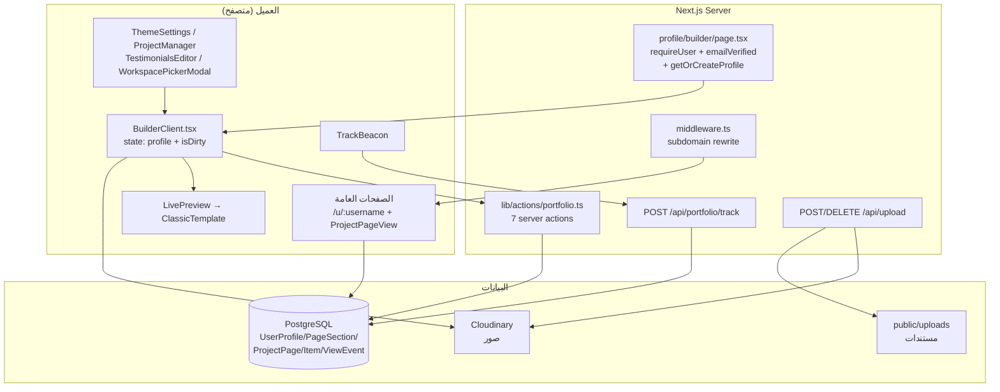
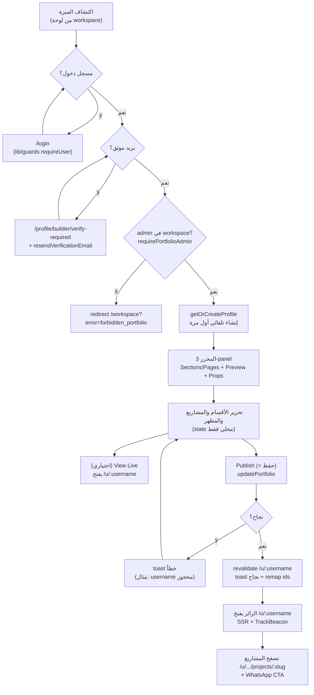
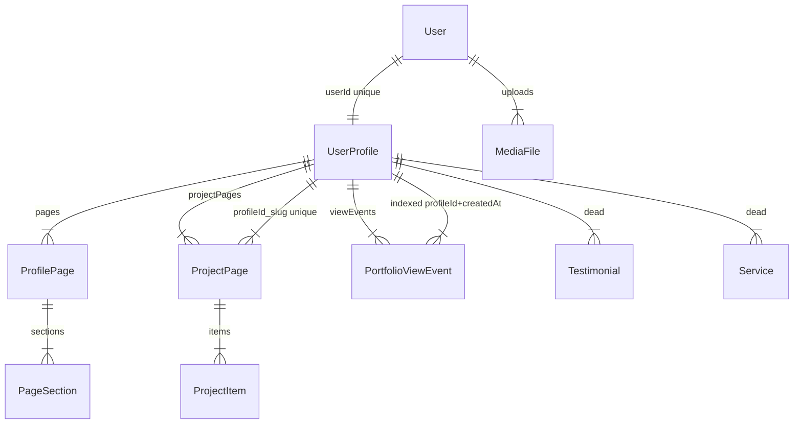

# التقرير الشامل لميزة Portfolio Builder — تحليل ستاتيكي موثّق بالكود

> **المنهجية:** تحليل ستاتيكي للكود فقط (static code analysis). لم يتم تشغيل اختبارات أو builds أو migrations أو أي أوامر تحقق runtime، ولم يتم تعديل أي كود أو بيانات. كل سلوك موثّق أدناه مدعوم بمسار ملف محدد. ما لم يمكن تأكيده من الكود موسوم `Needs Verification`.
> **تاريخ التحليل:** 2026-10-09 | **المشروع:** MarketOS / PortfolioHub (`marketos@0.1.0`, `next@16.2.12`, `react@19.2.4`, PostgreSQL + Prisma 5.22)

---

## جدول المحتويات

1. [الملخص التنفيذي](#1-الملخص-التنفيذي-executive-summary)
2. [معمارية الميزة](#2-معمارية-الميزة-architecture)
3. [رحلة العميل الكاملة](#3-رحلة-العميل-الكاملة-customer-journey)
4. [سير عمل إنشاء المحفظة](#4-سير-عمل-إنشاء-المحفظة-creation-workflow)
5. [المحرر وإدارة المحتوى](#5-المحرر-وإدارة-المحتوى-editor)
6. [القوالب والثيمات والتخصيص](#6-القوالب-والثيمات-والتخصيص-templates--themes)
7. [المعاينة والنشر والصفحات العامة](#7-المعاينة-والنشر-والصفحات-العامة-preview--publishing--public-pages)
8. [لوحة الإدارة وإدارة المحافظ](#8-لوحة-الإدارة-وإدارة-المحافظ-dashboard)
9. [واجهات Backend ومنطق الأعمال](#9-واجهات-backend-ومنطق-الأعمال-apis--business-logic)
10. [مخطط قاعدة البيانات ودورة حياة البيانات](#10-مخطط-قاعدة-البيانات-ودورة-حياة-البيانات-database-schema)
11. [المصادقة والتفويض والأمان](#11-المصادقة-والتفويض-والأمان-security)
12. [إدارة الوسائط والملفات](#12-إدارة-الوسائط-والملفات-media)
13. [التحقق ومعالجة الأخطاء والحالات الحدية](#13-التحقق-ومعالجة-الأخطاء-والحالات-الحدية-validation--errors)
14. [التكاملات والاعتماديات](#14-التكاملات-والاعتماديات-integrations--dependencies)
15. [تجربة المستخدم وإمكانية الوصول](#15-تجربة-المستخدم-وإمكانية-الوصول-ux--a11y)
16. [القيود والأخطاء والدين التقني](#16-القيود-والأخطاء-والدين-التقني-limitations--bugs--debt)
17. [جرد الميزات الكامل](#17-جرد-الميزات-الكامل-complete-feature-inventory)
18. [فهرس الملفات](#18-فهرس-الملفات-file-by-file-index)
19. [التوصيات والتحسينات المستقبلية](#19-التوصيات-والتحسينات-المستقبلية-recommendations)
20. [خارطة الطريق المقترحة](#20-خارطة-الطريق-المقترحة-roadmap)
21. [التقييم العام والأسئلة المعلقة](#21-التقييم-العام-والأسئلة-المعلقة-final-assessment)

---

## 1. الملخص التنفيذي (Executive Summary)

### ما هو Portfolio Builder؟

**Portfolio Builder** هو محرر محافظ شخصية مدمج في منصة MarketOS/PortfolioHub. يتيح للمستخدم الإداري (مالك workspace أو عضو `admin`) بناء صفحة بورتفوليو عامة ثنائية اللغة (عربي/إنجليزي، RTL-first) تُعرض على المسار العام `/u/:username`، مع صفحات مشاريع فرعية على `/u/:username/projects/:slug`، ونظام تحليلات زيارات مدمج.

### الغرض داخل المنصة

- تحويل مخرجات الـ workspace (استراتيجيات، خطط محتوى، منشورات، وسائط) إلى واجهة عامة قابلة للمشاركة عبر `WorkspacePickerModal`.
- منح كل مستخدم إداري هوية عامة واحدة (`UserProfile` واحد لكل `userId`) تُستخدم للتسويق الشخصي وجذب العملاء (زر WhatsApp، روابط التواصل).
- قياس الأداء عبر `PortfolioViewEvent` ولوحة `/profile/builder/analytics`.

### المستخدمون المستهدفون وأهدافهم

| المستخدم | الهدف |
|---|---|
| Freelancer / مستقل | عرض الأعمال السابقة والخدمات وجمع تواصل عبر WhatsApp |
| SMM / مسوّق | عرض الحملات والمحتوى المنشور كدليل أعمال |
| مستشار (Consultant) | عرض الخبرات والشهادات (testimonials) لبناء الثقة |

(الأدوار مستمدة من `Portfolio_Builder_PRD.md`؛ الكود نفسه لا يفرّق بين الأدوار — أي `admin` يحصل على نفس المحرر.)

### المشاكل التي يحلها

1. إنشاء صفحة تعريفية دون كتابة كود (محرر 3-panel بصري).
2. ربط المحفظة بمحتوى الـ workspace بدل إعادة الرفع.
3. دعم لغتين في نفس الصفحة مع معاينة حية فورية.
4. تتبع الزيارات دون خدمة خارجية.

### القدرات الرئيسية المواجهة للمستخدم

- محرر من 3 أعمدة: تنقل (Sections/Pages) + معاينة حية (desktop/mobile) + خصائص (ThemeSettings + محررات الأقسام).
- 8 أقسام افتراضية: `hero / about / experience / skills / services / projects / testimonials / footer`.
- صفحات مشاريع (`ProjectPage`) بعناصر مرتبطة (`ProjectItem`: روابط خارجية، نصوص، صور، عناصر workspace).
- تخصيص المظهر: ألوان (light/dark)، خط، `username`، شعار، أزرار عائمة (scroll-to-top / WhatsApp).
- حفظ يدوي واحد (`Publish` = `Save`) + زر `View Live`.
- لوحة تحليلات: إجمالي الزيارات، منحنى 30 يومًا، مشاهدات المشاريع، الدول، نقرات WhatsApp.

### العلاقة: إنشاء ← تحرير ← نشر ← عرض عام

لا توجد حالة `draft` حقيقية. زر `Publish` في `BuilderClient.tsx:2347-2355` يستدعي `handlePublish = handleSaveChanges` (`BuilderClient.tsx:591`) أي **الحفظ هو النشر**. الصفحة العامة `/u/:username` تقرأ مباشرة نفس السجلات بعد `revalidatePath`. حقل `isPublished` موجود على `ProfilePage` و `ProjectPage` (افتراضي `true`) لكن الـ builder لا يوفّر زر publish/unpublish منفصل — القيمة تُكتب فقط عبر `updateProjectPage(id, {isPublished})` العام.

### هل التنفيذ مكتمل؟

**مكتمل جزئيًا — الأساس يعمل، والتفاصيل ناقصة.** التدفق الرئيسي (إنشاء تلقائي للملف → تحرير → حفظ → عرض عام → تحليلات) مدعوم بالكود من الطرفين. لكن توجد فجوات موثقة في §16: لا حذف/تكرار للمحفظة نفسها، لا `unpublish` من الواجهة، مشروع منفرد غير منشور يبقى قابلًا للوصول العام (انظر §7)، تحقق ضعيف في عدة حقول، كود ميت (`Testimonial`/`Service` models + `SectionManager.tsx` + `lib/portfolio.ts` القديم).

### أهم الملاحظات المعمارية

1. **Server Actions بدل REST:** لا يوجد أي `api/portfolio/*` للـ CRUD — كل الطفرات عبر `src/lib/actions/portfolio.ts` (`getOrCreateProfile`, `updatePortfolio`, `create/update/deleteProjectPage`, `getAdminWorkspaceContent`, `getPortfolioAnalytics`). الـ route الوحيد هو `POST /api/portfolio/track` للتحليلات.
2. **المحتوى كـ JSON مرن:** الأقسام (`PageSection.content`) والمظهر (`UserProfile.appearance/localized/contactLinks`) مخزنة كـ `Json` بلا تحقق من مخطط — مرونة عالية مقابل سلامة نوع ضعيفة.
3. **قالب واحد فقط:** `ClassicTemplate.tsx` هو القالب الوحيد؛ لا يوجد registry قوالب رغم أن `appearance.theme='classic-dark'` يوحي بتعددها.
4. **بوابة `requirePortfolioAdmin`:** كل الـ actions تشترط ملكية workspace أو عضوية `admin` — المحفظة ليست متاحة لكل مستخدم مسجل.

### أهم القيود والمخاطر

| # | الخطر | الشدة |
|---|---|---|
| 1 | صفحة مشروع فردية تُعرض عامًا حتى لو `isPublished=false` (لا فلتر في `u/[username]/projects/[slug]/page.tsx:25-39`) — تسريب محتوى غير منشور | High |
| 2 | `updateProjectPage`/`deleteProjectPage` لا يتحققان من ملكية السجل (أي admin يستطيع تعديل/حذف مشروع مستخدم آخر عبر `id`) — IDOR محتمل | High |
| 3 | `updatePortfolio` يكتب `appearance/localized/contactLinks/sections` دون أي تحقق مخطط (mass assignment جزئي) | Medium |
| 4 | ملفات Cloudinary لا تُحذف من المزود عند الاستبدال/الحذف (يتامى تتراكم) | Medium |
| 5 | حد تحليلات `track` داخل الذاكرة (per-process) — لا يعمل عبر مثيلات متعددة | Low |

### جرد الميزات (Feature Inventory)

| Feature | Description | Implementation Status | Main Files | Notes |
|---|---|---|---|---|
| إنشاء الملف التلقائي | `getOrCreateProfile` ينشئ `UserProfile` + صفحة `home` + 8 أقسام عند أول زيارة | Implemented | `src/lib/actions/portfolio.ts:30-310`, `src/app/profile/builder/page.tsx:11-28` | `username` مولّد من الاسم/الإيميل مع حل تصادم |
| محرر 3-panel | تنقل يسار + معاينة وسط + خصائص يمين، desktop/mobile frames | Implemented | `src/app/profile/builder/BuilderClient.tsx` (~2786 سطر) | حفظ يدوي فقط؛ `useAutosave` موجود لكن غير مستخدم |
| أقسام المحتوى الثمانية | hero/about/experience/skills/services/projects/testimonials/footer: تحرير كامل + إظهار/إخفاء + سحب لإعادة الترتيب | Implemented | `BuilderClient.tsx:957-2447`, `TestimonialsEditor.tsx`, `ProjectManager.tsx` | `contact` القديم يُهاجَر تلقائيًا إلى `footer` |
| صفحات المشاريع | إنشاء/تحرير/حذف `ProjectPage` + عناصر `ProjectItem` بأنواع workspace/خارجية | Implemented | `BuilderClient.tsx:817-956`, `portfolio.ts:510-642` | روابط `page_link` القديمة تُحوَّل عند القراءة |
| ربط محتوى workspace | نافذة اختيار استراتيجيات/خطط/منشورات/وسائط | Implemented | `WorkspacePickerModal.tsx`, `getAdminWorkspaceContent:644-694` | مقيد بالـ workspaces التي يديرها المستخدم |
| تخصيص المظهر | ألوان light/dark، خط، username، شعار، أزرار عائمة، لغة افتراضية | Implemented | `ThemeSettings.tsx:68-350` | قالب واحد فقط رغم حقل `theme` |
| قوالب متعددة | لا يوجد سوى `ClassicTemplate` | Planned (غير موجود) | `src/components/portfolio/templates/ClassicTemplate.tsx` | `appearance.theme` يُكتب لكن لا يؤثر |
| معاينة حية | `LivePreview` يعكس الحالة المحلية فورًا (تشمل غير المحفوظ) | Implemented | `LivePreview.tsx:6-17` | المعاينة تعرض المسودات — مفيد لكن قد يربك |
| نشر/إلغاء نشر | زر `Publish` = حفظ؛ لا زر unpublish؛ لا مسودات | Partially Implemented | `BuilderClient.tsx:591, 2347` | `isPublished` موجود في DB لكن بلا واجهة |
| صفحة عامة `/u/:username` | SSR + metadata + `TrackBeacon page_view` | Implemented | `src/app/u/[username]/page.tsx` | تفلتر `isPublished:true` للصفحة والأقسام الرئيسية |
| صفحة مشروع عامة | SSR + `TrackBeacon project_view` | Partially Implemented | `src/app/u/[username]/projects/[slug]/page.tsx` | **لا تفلتر `isPublished`** — خلل موثق |
| Subdomain routing | `username.portfoliohub.com` → `/u/username` | Implemented | `src/middleware.ts:40-50` | يعتمد على `NEXT_PUBLIC_APP_URL` |
| تحليلات الزيارات | ingest عام + لوحة خاصة (30 يوم، مشاريع، دول، WhatsApp) | Implemented | `api/portfolio/track/route.ts`, `getPortfolioAnalytics:734-836`, `analytics/*` | إزالة التكرار لكل session؛ حد 60/min لكل IP |
| رفع الصور | Cloudinary unsigned + سجل `MediaFile` | Implemented | `api/upload/route.ts`, `lib/cloudinary.ts`, `lib/upload.ts` | صور ≤5MB؛ مستندات ≤20MB محليًا |
| حذف/استبدال الأصول مع التنظيف | حذف `MediaFile` يمسح القرص المحلي فقط؛ Cloudinary يتيم | Partially Implemented | `api/upload/route.ts:153-169`, `destroyCloudinaryAsset` غير مستدعى | Needs Verification للإدارة الكاملة |
| حذف/تكرار المحفظة | غير موجود في الواجهة ولا actions | Planned (غير موجود) | — | حذف المستخدم cascade فقط عبر DB |
| نطاقات مخصصة | غير موجود | Planned (غير موجود) | — | فقط subdomain تلقائي |
| SEO/social metadata | `generateMetadata` أساسي (title/description) بدون OG/Twitter/canonical/sitemap | Partially Implemented | `u/[username]/page.tsx:7-19` | بلا `openGraph` أو `sitemap.xml` للمحافظ |
| حدود Freemium | ثوابت `FREE_*_LIMIT` في `lib/portfolio.ts` القديم وغير مطبقة في actions الجديدة | Disabled / Dead | `src/lib/portfolio.ts:6` | الواجهة لا تعرض أي قيود |

---

## 2. معمارية الميزة (Architecture)

### الإطار واستراتيجية العرض

- **Next.js App Router** (`next@16.2.12`) + React 19. Server Components للبوابات والصفحات العامة (`profile/builder/page.tsx`, `u/[username]/page.tsx`) و Client Components للمحرر والقالب (`'use client'` في `BuilderClient`, `ClassicTemplate`, `ProjectPageView`, `TrackBeacon`).
- **لا REST للـ CRUD:** الطفرات عبر React Server Actions (`'use server'` في `src/lib/actions/portfolio.ts`). الـ fetch الوحيد من العميل للخادم خارج actions هو `POST /api/portfolio/track` و `POST/DELETE /api/upload` ورفع Cloudinary المباشر.
- **العرض العام SSR:** كل طلب `/u/:username` يستعلم Prisma مباشرة (لا كاش مخصص؛ الاعتماد على `revalidatePath` بعد الحفظ).

### الصفحات والتخطيطات

| المسار | النوع | الملف |
|---|---|---|
| `/profile/builder` | خاص (يتطلب login + بريد موثق + admin) | `src/app/profile/builder/page.tsx` + `BuilderClient.tsx` |
| `/profile/builder/analytics` | خاص (تحليلات المحفظة) | `src/app/profile/builder/analytics/page.tsx` |
| `/profile/builder/verify-required` | بوابة البريد غير الموثق | `verify-required/page.tsx` + `VerifyRequiredCard.tsx` |
| `/u/:username` | عام (SSR) | `src/app/u/[username]/page.tsx` |
| `/u/:username/projects/:slug` | عام (SSR) | `src/app/u/[username]/projects/[slug]/page.tsx` |

لا يوجد route باسم `portfolio` — التسمية الداخلية `portfolio` (actions/api) مقابل المسارات الظاهرة `profile/builder` و `u/`.

### المكونات ومسؤولياتها

- `BuilderClient.tsx` (~2786 سطر): الحاوية الجامعة — state مركزي `profile`، حفظ/نشر، تبويبات يسار، canvas وسط، `renderRightPanelContent` (محرر كل قسم)، إدارة صفحات المشاريع، dnd-kit لإعادة ترتيب الأقسام.
- `LivePreview.tsx`: غلاف يعرض `ClassicTemplate` داخل حاوية scroll مع `dir` حسب `appearance.defaultLanguage`.
- `ThemeSettings.tsx`: تبويب Theme & Bio الافتراضي (username, colorMode, font, ألوان، logo، actionButtons، اللغة).
- `SectionManager.tsx` (176 سطر): محرر أقسام قديم (`toggleVisibility`, `moveSection`, `updateSectionContent`) — **غير مستخدم** من `BuilderClient` (مستبدَل بـ `renderRightPanelContent`). كود ميت فعليًا.
- `ProjectManager.tsx` (619 سطر): محرر بطاقات المشاريع (card mode للصفحة الرئيسية) وعناصر المشروع (item mode) مع `linkType: none|external|page` ورفع الأغلفة و`WorkspacePickerModal`.
- `TestimonialsEditor.tsx` (224 سطر): إدارة عناصر `testimonials` داخل `PageSection.content.items` (إضافة/حذف/نقل/رفع صورة).
- `WorkspacePickerModal.tsx` (162 سطر): تبويبات `strategies|plans|posts|media|external` + بحث، يغذي `ProjectManager`.
- `ClassicTemplate.tsx` (1019 سطر): القالب الوحيد — hero + `renderSection` لكل `sectionType` + footer + أزرار عائمة + حقن خط Google ديناميكيًا.
- `TestimonialsSlider.tsx` (176 سطر): سلايدر متجاوب (3/2/1) + lightbox؛ يعرض فقط العناصر ذات `photoUrl`.
- `TrackBeacon.tsx` (86 سطر): ping تحليلات fire-and-forget مع إزالة تكرار `sessionStorage` ودعم `sendBeacon`.
- `analytics/`: `AnalyticsDashboard` + `ViewsChart` + `ProjectViews` + `TopLists` + `RadialGaugeCard` — عرض فقط، البيانات من Server Component.

### إدارة الحالة وتدفق البيانات

```
getOrCreateProfile() [server]
  → <BuilderClient initialProfile> [useState(profile)]
    → تحرير محلي (updateProfile setState) → isDirty عبر getProfileSnapshot()
    → handleSaveChanges → updatePortfolio({...}) [server action]
      → revalidatePath('/profile/builder', '/u/:username')
      → remap temp ids (new-*) → real ids في state المحلي
    → LivePreview/ClassicTemplate يقرأان نفس state → معاينة فورية (تشمل غير المحفوظ)
```

- لا مكتبة state خارجية؛ `useState` + `useMemo` + `useCallback` فقط.
- لا autosave: ملف `src/hooks/useAutosave.ts` موجود لكن **غير مستخدم** في الـ builder. التغييرات غير المحفوظة تضيع عند مغادرة الصفحة (لا يوجد `beforeunload` guard — انظر §16).
- لقطة الاتساخ: `getProfileSnapshot(profile)` (`BuilderClient.tsx:435`) تُقارن بـ `savedSnapshot` لإظهار `isDirty`.

### Composables والأدوات

- `uploadToCloudinary(file)` في `src/lib/cloudinary.ts:13` — رفع مباشر من المتصفح (unsigned preset) يُستخدم للأفاتار والأغلفة والشعارات وصور الشهادات.
- `useMounted()` في `src/lib/hooks/useMounted.ts` — guard للـ portal في السلايدر.
- `adjustColor`, `getIcon/ICON_MAP`, `normalizeContactUrl` (`lib/contact.ts`), `slugify/generateUsername` (`lib/portfolio.ts` القديم).
- `getFileType/FILE_SIZE_LIMITS/saveFileLocally` (`lib/upload.ts`) للخادم.

### التحقق في العميل

- `username`: تعقيم `[^a-z0-9]` في `ThemeSettings.tsx:121` (إزالة كل ما ليس لاتيني/رقم — **يشمل ذلك حذف الشرطات**، بينما الخادم يحوّلها إلى `-`؛ عدم اتساق موثق في §16).
- `ColorField`: تطبيع hex (`#rgb`/`#rrggbb`) مع fallback للقيمة الافتراضية عند الإدخال غير الصالح.
- عناصر المشروع الفارغة (كل الحقول فارغة) تُسقَط صامتة في الخادم (`updatePortfolio:473-479`).
- لا تحقق طول/صيغة لمعظم الحقول النصية، ولا تحقق URL فعلي في العميل (التطبيع في `normalizeContactUrl` لا يُستدعى في مسار الحفظ الجديد — Needs Verification إن كان يُستخدم).

### Backend: routes و handlers و services

| الطبقة | الملف | الدور |
|---|---|---|
| Server Actions | `src/lib/actions/portfolio.ts` | كل CRUD + analytics reads |
| Legacy service | `src/lib/portfolio.ts` (506 سطر) | دوال قديمة (`getOrCreateProfile(user)`, `upsertProfileData`) — **غير مستوردة من الـ builder** |
| Analytics ingest | `src/app/api/portfolio/track/route.ts` | `POST` عام، throttle داخل الذاكرة |
| Upload | `src/app/api/upload/route.ts` | `POST` multipart + `DELETE?id=` |
| Auth | `src/lib/auth.ts`, `src/lib/guards.ts` | session cookie + `requireUser` + `requirePortfolioAdmin` (داخل actions) |
| Subdomain | `src/middleware.ts:40-50` | rewrite `username.host` → `/u/username` |

### قاعدة البيانات

PostgreSQL حصرًا (`prisma/schema.prisma: datasource postgresql`). نماذج المحفظة: `UserProfile`, `ProfilePage`, `PageSection`, `ProjectPage`, `ProjectItem`, `Testimonial` (ميت), `Service` (ميت)، `PortfolioViewEvent`, `MediaFile`. التفاصيل الكاملة في §10.

### رفع الملفات والصور

مساران: (1) صور المحفظة (أفاتار/أغلفة/شعار/شهادات) تُرفع **من المتصفح مباشرة إلى Cloudinary** عبر `uploadToCloudinary` ثم يُخزَّن الـ URL في JSON المحفظة (بدون سجل `MediaFile` في هذا المسار — Needs Verification إن كان يُنشأ سجل)؛ (2) `POST /api/upload` للصور (→ Cloudinary + سجل `MediaFile`) والمستندات (→ قرص محلي `public/uploads` + سجل).

### العرض العام

`ClassicTemplate` يُستخدم في الموضعين (المعاينة الخاصة والعرض العام) مع نفس `profile` — الفارق أن المعاينة تقرأ state العميل (يشمل غير المحفوظ) بينما العام يقرأ DB. `ProjectPageView` منفصل لصفحة المشروع.

### الإعدادات ومتغيرات البيئة (أسماء فقط، بلا قيم)

`NEXT_PUBLIC_APP_URL` (للـ subdomain/base domain)، `NEXT_PUBLIC_CLOUDINARY_CLOUD_NAME`، `NEXT_PUBLIC_CLOUDINARY_UPLOAD_PRESET`، `CLOUDINARY_API_KEY`/`CLOUDINARY_API_SECRET` (للحذف — غير مستخدم فعليًا)، `DATABASE_URL`/`DIRECT_URL`، `SESSION_COOKIE_NAME`، `JWT_SECRET`. لا توجد متغيرات خاصة بالمحفظة (حدود، feature flags).

### مخطط المعمارية (Mermaid)



### جرد المكونات وخريطة الاعتماديات

| المكون | يعتمد على |
|---|---|
| `profile/builder/page.tsx` | `requireUser` (`lib/guards`), `getOrCreateProfile` (`actions/portfolio`), `BuilderClient` |
| `BuilderClient` | `updatePortfolio/createProjectPage/deleteProjectPage` (actions)، `uploadToCloudinary`، `LivePreview`, `ThemeSettings`, dnd-kit، `useToast` |
| `LivePreview` | `ClassicTemplate` |
| `ClassicTemplate` | `TestimonialsSlider`, `trackPortfolioEvent` (`TrackBeacon`), Google Fonts CDN |
| `ProjectManager` | `uploadToCloudinary`, `WorkspacePickerModal` |
| `WorkspacePickerModal` | `getAdminWorkspaceContent` (action) |
| `u/[username]/page.tsx` | Prisma مباشرة + `ClassicTemplate` + `TrackBeacon` |
| `ProjectPageView` | لا شيء (render صرف) |
| `analytics/page.tsx` | `getPortfolioAnalytics` + `AnalyticsDashboard` |
| `track/route.ts` | Prisma فقط (بلا auth) |
| `upload/route.ts` | `getCurrentUser`, `lib/upload`, Cloudinary API, Prisma `MediaFile` |

---

## 3. رحلة العميل الكاملة (Customer Journey)



### الخطوات تفصيلًا

| # | الخطوة | الصفحة/المكون | ما يراه العميل | الإجراءات | المدخلات المطلوبة | التحقق | سلوك الواجهة | طلب Backend | أثر DB | النجاح/الفشل | الملفات |
|---|---|---|---|---|---|---|---|---|---|---|---|
| 1 | اكتشاف الميزة | لوحة workspace | رابط/زر للمحرر (Needs Verification للنص الدقيق) | نقر للانتقال | — | — | تنقل عادي | — | — | — | Needs Verification لمسار الدخول الدقيق |
| 2 | الوصول من اللوحة | `/profile/builder` | المحرر أو redirect | فتح تلقائي | جلسة صالحة | `requireUser` → `/login` | Server redirect | قراءة session | تحديث `lastLoginAt` (Needs Verification) | redirect أو عرض | `profile/builder/page.tsx:11-16` |
| 3 | شرط البريد | بوابة `emailVerified` | صفحة `verify-required` مع زر إعادة الإرسال + cooldown | طلب رابط جديد | بريد الحساب | `user.emailVerified` | `maskEmail` + حالات `sending/sent/failed` | `resendVerificationEmail` | إنشاء token تحقق | redirect للعودة بعد التوثيق | `page.tsx:14-16`, `VerifyRequiredCard.tsx:11-93` |
| 4 | شرط الصلاحية | `requirePortfolioAdmin` | redirect صامت لـ workspace مع خطأ | — | ملكية workspace أو عضوية admin مقبولة | فحص `workspace.ownerId` أو `workspaceMember(role=admin, acceptedAt!=null)` | redirect | استعلامان Prisma | — | `Forbidden` → `/workspace?error=forbidden_portfolio` | `actions/portfolio.ts:9-28`, `builder/page.tsx:19-26` |
| 5 | بدء محفظة جديدة | تلقائي | المحرر مملوء بمحتوى فارغ افتراضي | لا شيء (فوري) | — | — | عرض فوري | `getOrCreateProfile` | `userProfile.create` + صفحة `home` + 8 أقسام | ملف جاهز للتحرير | `actions/portfolio.ts:247-310` |
| 6 | اختيار template | **غير مدعوم** | لا يوجد منتقي قوالب | — | — | — | — | — | — | خطوة مفقودة — قالب واحد ثابت | `ClassicTemplate.tsx` (الوحيد) |
| 7 | المعلومات الشخصية | تبويب Theme & Bio + قسم hero/about | حقول الاسم/اللقب/النبذة (ar/en)، الأفاتار، الموقع | كتابة + رفع صورة | لا شيء إجباري | شبه معدوم (Needs Verification للأطوال) | state محلي + معاينة فورية | يُرسَل ضمن `updatePortfolio` | `localized`, `avatarUrl`, `contactLinks` | toast نجاح/خطأ عند الحفظ | `ThemeSettings.tsx`, `BuilderClient:1201-1475` |
| 8 | الأقسام (خبرات/تعليم/مهارات/خدمات/...) | اللوحة اليمنى حسب القسم | قوائم عناصر قابلة للإضافة/الحذف/النقل | CRUD محلي + رفع شعارات/صور | — | إسقاط العناصر الفارغة صامتًا | فوري محليًا | ضمن `updatePortfolio.sections` | `pageSection.update` لكل قسم | يُرى في المعاينة فورًا | `BuilderClient:1476-2185`, `TestimonialsEditor` |
| 9 | رفع الصور | أزرار رفع في كل محرر | معاينة الصورة + حالة رفع | اختيار ملف | صورة (JPG/PNG/WebP/GIF) | عميل: `validateFile` (50MB في `cloudinary.ts`)؛ خادم `/api/upload`: صور ≤5MB | رابط URL يُحقن في الحقل | `fetch Cloudinary` مباشر أو `POST /api/upload` | تخزين URL في JSON؛ `MediaFile` حسب المسار | خطأ نصي عند الفشل | `cloudinary.ts:13-42`, `upload/route.ts:49-114` |
| 10 | التخصيص البصري | `ThemeSettings` | منتقي ألوان + خطوط + أوضاع + شعار + WhatsApp | تغيير + `Reset to defaults` | — | تطبيع hex صارم | CSS vars فورية في المعاينة | ضمن `appearance` | `userProfile.appearance` | فوري بصريًا؛ يُحفَظ مع الحفظ | `ThemeSettings.tsx:68-350` |
| 11 | حفظ المسودة | زر `Publish` السفلي/العلوي | حالة `saving/saved/error` + `lastSaved` | نقر حفظ | — | `username` فريد | toast + `isDirty=false` | `updatePortfolio` | تحديث profile/sections/projects + حذف المشاريع المحذوفة | `savedProjects` لإعادة ربط ids | `BuilderClient:522-591` |
| 12 | المعاينة | Canvas وسط + `View Live` | عرض desktop/mobile + رابط عام | تبديل وضع + فتح رابط | — | روابط `new-*` تُعطَّل قبل الحفظ | `LivePreview` يعكس **غير المحفوظ** | — (محلي) أو GET عام | — | رابط معطل بصريًا للمشاريع غير المحفوظة | `BuilderClient:2317-2345, 2400-2421` |
| 13 | النشر | نفس زر الحفظ | لا تمييز بين حفظ ونشر | — | — | — | `revalidatePath` يُحدِّث العام فورًا | `updatePortfolio` | نفس أثر الحفظ | التغييرات ظاهرة عامًا فور الحفظ | `actions/portfolio.ts:498-501` |
| 14 | الوصول للرابط العام | `/u/:username` | الصفحة العامة الكاملة | مشاركة الرابط | — | `username` موجود + صفحة `home` منشورة | SSR مباشر | `findUnique` مع include | — (قراءة) | `notFound()` عند الغياب | `u/[username]/page.tsx:21-49` |
| 15 | تحرير محفظة قائمة | نفس المحرر | نفس الواجهة محملة بالبيانات | نفس الإجراءات | — | ترحيلات تلقائية (experience/footer/testimonials) عند الفتح | قد تتغير `sectionOrder` تلقائيًا | `getOrCreateProfile` (migration) | إنشاء/حذف أقسام تلقائيًا | المستخدم قد يرى أقسامًا جديدة لم ينشئها | `actions/portfolio.ts:47-221` |
| 16 | إلغاء النشر/الحذف/التكرار | **غير مدعوم** | لا أزرار؛ `isPublished` يُعرض شارة فقط في قائمة Pages | — | — | — | — | — | — | خطوات مفقودة | `BuilderClient:2619` (شارة قراءة فقط) |

---

## 4. سير عمل إنشاء المحفظة (Creation Workflow)

### كيف يبدأ؟

لا يوجد زر "إنشاء محفظة" — أول `GET /profile/builder` بعد استيفاء الشروط يستدعي `getOrCreateProfile()` (`builder/page.tsx:20`) الذي يبحث بـ `userId`، فإن غاب السجل أنشأه فورًا مع كل البنية الافتراضية. أي **الإنشاء فوري من الخادم قبل أي إدخال**.

### لحظة إنشاء السجل

فورية في قاعدة البيانات (`userProfile.create` مع `pages.create` متداخل و`sections.create` لثمانية أقسام — `actions/portfolio.ts:260-306`). لا توجد مرحلة مسودة قبل الإنشاء.

### البيانات الأولية والقيم الافتراضية

- `username`: من `displayName` أو مقطع الإيميل، lowercase، إزالة `[^a-z0-9]`، حل تصادم بإلحاق عدّاد (`baseUsername + counter`) — `actions/portfolio.ts:249-258`.
- `displayName`: اسم المستخدم؛ `appearance = {colorMode:'light', theme:'classic-dark', font:'inter', primaryColor:'#0066cc'}`.
- `localized = {displayName:{en,ar:''}, bio:{en:'',ar:''}, professionalTitle:{en:'',ar:''}}`؛ `contactLinks=[]`.
- صفحة `home` (`slug:'home'`, `isPublished:true`) + 8 أقسام `sectionOrder 1..8` بمحتوى فارغ/عناوين افتراضية (hero/about/experience/skills/services/projects/testimonials/footer) — كلها `settings:{isVisible:true}`.

### القوالب والمحتوى التمهيدي

لا starter content حقيقي — الحقول فارغة (`title:{en:'',ar:''}`) ما عدا عناوين الأقسام الافتراضية (مثل `Work Experience`/`Testimonials`/`Work with me`). لا بيانات مثال ولا معالج onboarding.

### حقول مطلوبة مقابل اختيارية

**لا يوجد أي حقل إجباري على مستوى الخادم** — `updatePortfolio` يقبل كل شيء اختياريًا (`username?`, `avatarUrl?`, ...). حتى `title` الفارغ للمشروع يصبح `'Untitled'`. النشر بمحفظة فارغة تمامًا ممكن تقنيًا (صفحة عامة بعناوين فارغة).

### نموذج النموذج (form model)

صفحة واحدة بـ 3 أعمدة (وليست multi-step). حالة النموذج في `useState(profile)` بالعميل؛ لا مزامنة بين الخطوات لأنها صفحة واحدة. الإرسال دفعة واحدة عبر `updatePortfolio({id, username, avatarUrl, appearance, localized, contactLinks, sections, projects})` (`BuilderClient:526-535`).

### تحقق الخادم ومعالجة الأخطاء

- `username` مأخوذ كما هو + فحص تفرد (`findUnique`) → `{success:false, error:'Username is already taken'}` يُعرض كـ toast (`BuilderClient:580-583`).
- أقسام بلا `id` تُتجاهَل صامتة (`actions/portfolio.ts:348`).
- عناصر مشاريع فارغة تُسقَط صامتة؛ أنواع غير معروفة تُجبَر إلى `external_link`.
- أي استثناء → `{success:false, error: message}` + `console.error` — يُعرض `message` الخام للمستخدم (تسريب رسائل داخلية محتمل، Low).

### الانعكاس في الواجهة

عند النجاح: `lastSaved=now`، إعادة ربط `tempId → real id/slug` للمشاريع الجديدة (`BuilderClient:539-576`)، `savedSnapshot` جديد (`isDirty=false`)، `toast('success')`. عند الفشل: `saveStatus='error'` + toast.

### تكرار المحافظ والحدود

- محفظة واحدة فقط لكل مستخدم (`userId @unique`). لا محافظ متعددة، لا حدود إنشاء (لا شيء يمنع/يحد)، لا اشتراك/خطة مرتبطة بالمحفظة في الكود الحالي.

### جرد حقول الإنشاء (forms field inventory)

| النموذج | Label | Property | Input type | Required | Validation | Default | المصدر → التخزين |
|---|---|---|---|---|---|---|---|
| Theme & Bio | Username (URL) | `profile.username` | text | لا | عميل: strip `[^a-z0-9]`؛ خادم: تفرد فقط | مولّد تلقائي | state → `userProfile.username` |
| Theme & Bio | Color mode | `appearance.colorMode` | select light/dark | لا | — | `light` | state → `appearance` JSON |
| Theme & Bio | Font | `appearance.font` | select (Inter/Poppins/...) | لا | — | `inter` | state → `appearance` + حقن Google Font |
| Theme & Bio | Primary/Border/Outline/Bg/Text colors | `appearance.*Color*` | color + hex text | لا | تطبيع hex | `#60a5fa`... (reset) / `#0066cc` (إنشاء) | state → CSS vars + DB |
| Theme & Bio | Default language | `appearance.defaultLanguage` | select en/ar/both | لا | — | `en` | state → `dir` + `lang` الافتراضية |
| Theme & Bio | Logo | `appearance.logoUrl` | file upload + URL text | لا | صور فقط | — | Cloudinary → URL |
| Theme & Bio | WhatsApp number | `appearance.actionButtons.whatsappNumber` | tel text (+placeholder `+201234567890`) | لا | **لا تحقق صيغة** — أي نص | — | state → رابط `wa.me` عام |
| Hero | Title/Subtitle (ar/en) | `section.content.title/subtitle` | text per-lang | لا | — | `''` | sections → `PageSection.content` |
| Hero | Avatar/Cover | `profile.avatarUrl` / cover | upload + URL | لا | صور | — | Cloudinary → URL |
| About | Biography (ar/en), stats | `content.biography/text/stats` | textarea + list | لا | — | `''` | sections → content |
| Skills | Skills list | `content.skills[]` | tag input + level | لا | — | `[]` | sections → content |
| Experience | jobTitle/company/location/dates/current/description | `content.items[]` | مجموعة حقول | لا | — | `[]` | sections → content |
| Services | title/description/features (+price في model الميت) | `content.items[]` | مجموعة حقول | لا | — | `[]` | sections → content |
| Projects (home) | cards → linkType/page/external | `ProjectPage.*` + items | mixed | لا | slug مولّد من title | `Untitled` | projects → `ProjectPage/Item` |
| Testimonials | name/title/photo/text/rating | `content.items[]` | mixed + upload | لا | — | `[]` | sections → content |
| Footer | headline/subheading/links | `content.headline/subheading/links` | text + social list | لا | تطبيع URL جزئي (`normalizeContactUrl` — Needs Verification للاستدعاء) | عناوين افتراضية | sections/contactLinks |

---

## 5. المحرر وإدارة المحتوى (Editor)

### جدول الأقسام

| Section | Supported Fields | Customer Actions | Validation | Persistence | Public Display |
|---|---|---|---|---|---|
| `hero` | title/subtitle (ar/en)، avatar، cover، CTA | تحرير نصوص + رفع صور | لا | صريح (زر حفظ) ضمن `sections[]` | أعلى الصفحة؛ fallback اسم المستخدم عند الفراغ |
| `about` | biography/text (ar/en)، stats (value+label) | إضافة/حذف إحصائيات | لا | صريح | شبكة نص + إحصائيات؛ نص `لا يوجد نص/No about text` عند الفراغ |
| `experience` | items: jobTitle/company/location/startDate/endDate/current/description | CRUD عناصر + (ترتيب؟ Needs Verification) | لا | صريح | Timeline؛ يُخفى القسم إن فرغ؟ (يعرض عنوانًا فارغًا — Needs Verification) |
| `skills` | skills[] (name+level/category) | إضافة/حذف | لا | صريح | أشرطة مهارات متحركة (IntersectionObserver) |
| `services` | items: title/description/features | CRUD عناصر | لا | صريح | بطاقات؛ ملاحظة: model `Service` المنفصل **غير مستخدم** |
| `projects` | بطاقات مرتبطة بـ `ProjectPage` (title/cover/tags/linkType) | إنشاء صفحة مشروع + ربط + حذف | slug تلقائي + إسقاط الفارغ | صريح (create فوري عند `handleCreateProjectPage` ثم حفظ جماعي) | شبكة بطاقات تربط `/projects/:slug` |
| `testimonials` | items: name/title/photoUrl/text/rating/icon/title/subtitle | CRUD + نقل + رفع صورة (`TestimonialsEditor`) | لا | صريح | `TestimonialsSlider` — **فقط عناصر ذات `photoUrl`** (`TestimonialsSlider.tsx:51`) |
| `footer` | headline/subheading/links (social) | تحرير + إضافة/حذف روابط | تطبيع URL جزئي | صريح (+ `contactLinks` الجذري) | فوتر + أيقونات اجتماعية + WhatsApp FAB |

### عمليات CRUD والعناصر المتعددة

كل الأقسام تدعم عناصر متعددة (`content.items[]`) ما عدا hero/footer (كتلة واحدة). الحذف محلي فوري (يُثبَّت بالحفظ). **لا ترتيب عناصر داخل القسم عبر dnd** — السحب (`dnd-kit` + `arrayMove`) مطبق على **ترتيب الأقسام نفسها** فقط (`handleDragEnd:683` → `sectionOrder=i+1`).

### الظهور والترتيب

- زر عين لكل قسم (`toggleSectionVisibility:628`) يكتب `visible` + `settings.isVisible` معًا (ازدواجية مقصودة للتوافق).
- `isSectionVisible` في القالب (`ClassicTemplate.tsx:156-169`) يقبل `visible` و`settings.isVisible` (string/boolean) — الافتراضي ظاهر.
- إعادة الترتيب بالسحب تُحدِّث `sectionOrder` محليًا وتُحفَظ دفعة واحدة.

### الحفظ وفقدان التغييرات

- **لا autosave ولا `beforeunload` guard.** `isDirty` يُحسب (`getProfileSnapshot`) ويُعرض (Needs Verification لموضع المؤشر) لكن المغادرة قبل الحفظ **تفقد كل شيء** — أهم UX gap.
- المعاينة تعكس غير المحفوظ (قد يظن المستخدم أنه نُشر).
- `ProjectPage` الجديدة تُنشأ في DB فورًا عبر `createProjectPage` عند إنشائها من تبويب Pages (`handleCreateProjectPage:817`) لكن حقولها تُحفَظ ضمن الدفعة الجماعية.

### الحالات الفارغة والاعتماديات

- `ClassicTemplate` يحقن `footer-default-fallback` عند غياب footer (`ClassicTemplate.tsx:90-108`).
- قسم `contact` القديم يُستبعد من العرض (`filter !== 'contact'`) ويُهاجَر في العميل والخادم.
- التباين الموثق: `TestimonialsSlider` يسقط الشهادات بلا صورة **بصمت** — المستخدم يرى شهادته في المعاينة؟ (Needs Verification: هل المعاينة تستخدم نفس الفلتر — نعم، نفس المكون، فيُسقطها أيضًا دون تفسير).

### التفاعلات (dialogs/drawers/menus)

- `WorkspacePickerModal`: بحث + تبويبات + اختيار خارجي (URL+title) — يغذي `ProjectManager.handlePickerSelect:167`.
- `IconPicker` (`BuilderClient:63`): أيقونات `ICON_OPTIONS` للأقسام.
- `SortableSectionItem` (`BuilderClient:340`): عنصر قابل للسحب بلوحة المفاتيح أيضًا (`KeyboardSensor`).
- `FormCard/ItemCard/AddActionCard` (`BuilderClient:280-312`): حاويات تحرير موحدة.
- تأكيدات الحذف: Needs Verification (لم يُرصد `confirm()` صريح في المقاطع المقروءة — يُذكر كسؤال معلق).

---

## 6. القوالب والثيمات والتخصيص (Templates & Themes)

### القوالب المتاحة وكيفية اختيارها

**لا يوجد أي قالب سوى `ClassicTemplate`.** لا منتقي قوالب، لا registry، لا `templates/` إضافي (مجلد `tepmlates/` في الجذر اسم مختلف ومحتواه غير مرتبط — Needs Verification لمحتواه). حقل `appearance.theme` يُخزَّن (`'classic-dark'` افتراضيًا) لكن **لا يُقرأ في أي مكان** (البحث لا يُظهر أي `switch(theme)`).

| Identifier | Purpose | Location | Features | Limitations |
|---|---|---|---|---|
| `ClassicTemplate` (الوحيد) | كل العرض العام والمعاينة | `src/components/portfolio/templates/ClassicTemplate.tsx` | hero/about/skills/experience/services/testimonials/projects/footer، لغتان، وضع ليلي/نهاري للزائر، أزرار عائمة، خط ديناميكي | لا بدائل؛ كسر `adjustColor` مع ألوان non-hex (ينتج `#NaN` — انظر §16)؛ `ICON_MAP` محدود (~25 أيقونة) |

### إعدادات المظهر (Theme configuration)

`appearance` JSON (بلا مخطط):

```
{ colorMode, theme, font, primaryColor, borderColor, outlineColor,
  bgColorLight, textColorLight, bgColorDark, textColorDark,
  defaultLanguage, logoUrl, actionButtons: {showScrollToTop, showWhatsapp, whatsappNumber} }
```

- تُطبَّق كـ CSS variables (`--color-primary/bg/text/card/border/outline`) في `ClassicTemplate:142-154`.
- الزائر يستطيع تبديل `lang` و`theme` محليًا (`useState` + `localStorage portfolio-theme` في `ProjectPageView:44`) — تفضيل الزائر يتجاوز افتراضيات المالك.
- الخطوط: قائمة ثابتة في `ThemeSettings:142-163` (Inter/Poppins/.../Playfair) تُحقن من Google Fonts (`fontLink:126`) — **طلب خارجي غير مشروط** في كل عرض (خصوصية/أداء، Low).

### الألوان والخطوط والتخطيط

- لوحة كاملة لكل وضع (bg/text/border/outline/primary) + `Reset to defaults` (`#60a5fa`...).
- لا تنويعات تخطيط (layout variants) ولا ترتيب أقسام مخصص beyond السحب اليدوي ولا خلفيات/زخارف.
- `displayMode: grid|list` خاص بصفحات المشاريع (`ProjectPageView:67`) — أقرب شيء لـ layout variant.

### الاستجابة والأوضاع

- القالب متجاوب (Tailwind responsive؛ سلايدر 3/2/1). المحرر نفسه متجاوب (drawer يسار + bottom-sheet يمين على `<lg`).
- الوضع الليلي/النهاري **للزائر** (`theme` state) منفصل عن `builderDarkMode` (مظهر المحرر نفسه).

### المعاينة الحية

تعكس `state` العميل فورًا **بما فيه غير المحفوظ** — سلوك مقصود للمحرر لكنه يخلط بين "معاينة المسودة" و"المنشور" (لا شارة تمييز — Needs Verification).

### CSS مخصص

غير مدعوم. لا حقول custom CSS.

### تغيير القالب لاحقًا / القيم المفقودة

لا معنى له (قالب واحد). القيم المفقودة لها fallbacks صلبة (`primary '#60a5fa'`, bg `#f9fafb/#111827`...) — لا تنكسر الصفحة عادة إلا مع `adjustColor` على قيم غير hex.

> **تنبيه:** `ThemeProvider/ThemeToggle` الخاصان بالتطبيق (dark mode العام) غير مرتبطين بمظهر المحفظة — عدم الخلط بينهما.

---

## 7. المعاينة والنشر والصفحات العامة (Preview, Publishing & Public Pages)

### المسارات والمكونات

| الغرض | المسار | المكون | الملف |
|---|---|---|---|
| معاينة المحرر (مسودة) | داخل canvas (ليست route) | `LivePreview → ClassicTemplate` | `builder/LivePreview.tsx` |
| معاينة صفحة مشروع (مسودة) | داخل canvas | `ProjectPagePreview` | `BuilderClient.tsx:95` |
| صفحة عامة | `/u/:username` | `ClassicTemplate` | `u/[username]/page.tsx` |
| مشروع عام | `/u/:username/projects/:slug` | `ProjectPageView` | `u/[username]/projects/[slug]/page.tsx` |
| رابط مباشر بديل | `https://:username.:baseDomain/...` (rewrite) | نفس الصفحات | `middleware.ts:46-50` |

### توليد الـ slug وتفرده

- `username`: تعقيم مختلف بين العميل (`[^a-z0-9]` حذف — `ThemeSettings:121`) والخادم (`[^a-z0-9]+ → -` في `updatePortfolio:388-390`؛ إزالة شرطات الأطراف؛ fallback `'project'`) — **عدم اتساق**: اسم بمسافة يُعرض محليًا بلا مسافة لكن يُحفظ بشرطة. تفرد عالمي (`@unique`) مع خطأ لطيف عند التصادم.
- `slug` المشروع: من `title` (`lower/trim/[^a-z0-9]+→-/trim -`) أو `proj.slug` المحفوظ (يُعاد تعقيمه) ما لم يبدأ بـ `project-new-/new-` فيُعاد توليده؛ إزالة تكرار **داخل الدفعة فقط** (`usedSlugs` محلي) — تصادم مع سجل DB موجود لنفس الملف **غير مفحوص** هنا (يعتمد على قيد `@@unique([profileId, slug])` الذي سيُفشل بexception خام — Medium، انظر §16). `createProjectPage` المنفصل يفحص التصادم ويُلحق لاحقة عشوائية (`portfolio.ts:535-540`).

### الحالات: مسودة/منشور

لا حالة مسودة. `isPublished` (افتراضي `true`) يُقرأ في:

- `/u/:username`: `pages where {slug:'home', isPublished:true}` + `projectPages where {isPublished:true}` — سليم.
- `/u/:username/projects/:slug`: **بلا فلتر `isPublished`** (`page.tsx:25-39`) — أي مشروع معروف الـ slug يُعرض حتى لو غير منشور. **مؤكد بالقراءة.**

### النشر وإلغاؤه

النشر = الحفظ (`revalidatePath`). لا endpoint إلغاء؛ لا واجهة لتبديل `isPublished` (الشارة في `BuilderClient:2619` عرض فقط حسب الاستكشاف). إلغاء النشر الفعلي يتطلب كتابة DB مباشرة — **وظيفة مفقودة**.

### الوصول والظهور

- الصفحات العامة بلا auth تمامًا (SSR عام). لا حماية بكلمة مرور للمحفظة في هذا المسار (ملاحظة: تقرير معماري ذكر `portfolio_unlocked_<username>` لكن **لم يُعثر عليه في كود المحفظة المقروء** — Needs Verification إن كان لمسار آخر/قديم).
- التغييرات المنشورة تظهر فورًا (ISR revalidate) — لا خطوة نشر ثانية.
- الأصول العامة: روابط Cloudinary/`/uploads` مباشرة بلا توقيع — أي URL معروف قابل للوصول.

### SEO والمشاركة

- `generateMetadata`: `title` + `description` فقط (من `displayName/username/bio`) — بلا `openGraph`/`twitter`/`canonical`/`robots`.
- لا `sitemap.xml` للمحافظ ولا `robots.txt` مخصص (الـ middleware يستثنيهما فقط).
- `TrackBeacon` لا يؤثر على SEO (client-only، `return null`).

### تسليم الصور والأخطاء

- الصور من CDN خارجي (Cloudinary) أو `/uploads` المحلي — بلا `next/image` optimization في القالب (وسوم `img` خام حسب الاستكشاف — Needs Verification الكامل).
- محافظ/مشاريع مفقودة → `notFound()` (صفحة 404 الافتراضية). أخطاء DB في العام → exception غير مُعالَج (500) — لا `error.tsx` خاص (Needs Verification).

### الفروق: معاينة مقابل عام

| البعد | المعاينة (`LivePreview`) | العام (`/u/:username`) |
|---|---|---|
| مصدر البيانات | state العميل (يشمل غير المحفوظ) | DB (المنشور فقط) |
| الأقسام المخفية | تُعرض؟ (Needs Verification — على الأرجح تُعرض لأن نفس المكون يفلتر `isVisible`... **تحقق**: `ClassicTemplate` يفلتر `visibleSections` أي المخفي لا يظهر حتى في المعاينة) | لا تظهر |
| التتبع | لا `TrackBeacon` | `TrackBeacon page_view` |
| البيانات المكشوفة | كل state (بما فيه روابط غير محفوظة) — محلي فقط | نفس الحقول عمليًا (لا فصل حقيقي — كل JSON المحفظة يُمرَّر للقالب) |

> **ملاحظة خصوصية:** لا يوجد فصل بين "بيانات التحرير" و"بيانات العرض" — أي حقل في `appearance/localized` يُرسَل للعميل العام ضمن `profile`. لا تخزين أسرار هناك حاليًا، لكن لا ضمان هيكلي.

---

## 8. لوحة الإدارة وإدارة المحافظ (Dashboard)

المحرر نفسه هو لوحة الإدارة (لا صفحة "محافظي" منفصلة — محفظة واحدة لكل مستخدم).

| Capability | Status | UI | Backend | Auth | ملاحظات |
|---|---|---|---|---|---|
| عرض كل المحافظ | غير منطبق (واحدة فقط) | — | — | — | لا تعدد محافظ |
| تمييز منشور/مسودة | Partially (شارة `isPublished` في قائمة Pages) | `BuilderClient:2619` | قراءة ضمن `getOrCreateProfile` | admin | عرض فقط |
| فتح المحرر | Implemented | `/profile/builder` | `getOrCreateProfile` | login+verified+admin | — |
| معاينة | Implemented | canvas + `View Live` | — | — | — |
| نشر/إلغاء نشر | Partially (نشر=حفظ؛ إلغاء مفقود) | زر `Publish` | `updatePortfolio` | admin | — |
| تغيير الاسم/slug | Implemented (username + title/slug المشروع) | `ThemeSettings` + حقول المشروع | `updatePortfolio/updateProjectPage` | admin | username فريد عالميًا |
| تكرار المحافظ/المشاريع | غير مدعوم | — | — | — | مفقود |
| حذف المحفظة | غير مدعوم (UI/actions) | — | cascade عند حذف المستخدم فقط | — | مفقود — المستخدم العادي لا يستطيع حذف محفظته |
| تحليلات/زيارات | Implemented | `/profile/builder/analytics` | `getPortfolioAnalytics` | admin (مالك الملف فقط عبر `userId`) | 7/30 يوم + مشاريع + دول + WhatsApp |
| نطاقات مخصصة | غير مدعوم | — | — | — | فقط subdomain تلقائي |
| مشاركة الروابط | Implemented (نسخ + `View Live`) | `AnalyticsDashboard:90` (`clipboard`), زر `View Live` | — | — | — |
| حدود الإنشاء/الاشتراك | غير موجود | — | — | — | `isPro` مذكور في تقارير قديمة كـ stub — Needs Verification |

---

## 9. واجهات Backend ومنطق الأعمال (APIs & Business Logic)

### الجرد الشامل

| Method | Endpoint / Handler | Purpose | Authentication | Authorization | Request Data | Response | Database Effects | Source Files |
|---|---|---|---|---|---|---|---|---|
| — (Server Action) | `getOrCreateProfile()` | جلب/إنشاء الملف + ترحيلات تلقائية | session cookie عبر `requirePortfolioAdmin` | مالك workspace أو admin مقبول | — | `profile` كامل (pages+sections+projectPages+items) | `findUnique`؛ `create` أول مرة؛ `delete/update/create` للترحيلات | `lib/actions/portfolio.ts:30-310` |
| — (Server Action) | `updatePortfolio(data)` | حفظ جماعي لكل المحفظة | نفس البوابة | نفسها (بلا فحص ملكية سجل إضافي — `where:{userId}`) | `{id, username?, avatarUrl?, appearance?, localized?, contactLinks?, sections?[], projects?[]}` | `{success, savedProjects[]}` أو `{success:false, error}` | `userProfile.update`؛ `pageSection.update` لكل قسم؛ create/update للمشاريع + `deleteMany/createMany` للعناصر + حذف المشاريع الغائبة | `portfolio.ts:312-508` |
| — (Server Action) | `createProjectPage(title?)` | إنشاء صفحة مشروع فارغة | نفس البوابة | نفسها | `title?` (بتوقيع ملتبس `titleOrProfileId?`) | `{success, page/projectPage/id/slug/title}` | `findUnique profile` + `findFirst` تصادم + `count` للترتيب + `create` | `portfolio.ts:510-580` |
| — (Server Action) | `updateProjectPage(id, data)` | تحديث مشروع + استبدال عناصره | نفس البوابة | **بلا فحص ملكية** (أي admin + id) | `{...pageData, items?[]}` | `{success, projectPage}` | `update` + `deleteMany/createMany` items + refetch | `portfolio.ts:582-629` |
| — (Server Action) | `deleteProjectPage(id)` | حذف مشروع | نفس البوابة | **بلا فحص ملكية** | `id` | `{success}` | `delete` (cascade items) | `portfolio.ts:631-642` |
| — (Server Action) | `getAdminWorkspaceContent()` | محتوى الـ workspaces للمنتقي | نفس البوابة | workspaces المملوكة/المُدارة فقط | — | `{workspaces, strategies, contentPlans, posts, media}` | قراءات `findMany` (selects محدودة) | `portfolio.ts:644-694` |
| — (Server Action) | `getPortfolioAnalytics()` | مجاميع التحليلات الخاصة | نفس البوابة | ملف المستخدم نفسه (`where:{userId}`) | — | `PortfolioAnalytics` (12 عدًا + daily + projects + countries) | 11× `count` + `findMany(30d)` | `portfolio.ts:734-836` |
| POST | `/api/portfolio/track` | ingest حدث مشاهدة | عام (بلا session) | throttle 60/min لكل IP | `{username≤64!, eventType∈{page_view,project_view,whatsapp_click}!, projectSlug≤200?}` | دائمًا `202 {ok:true/false}` (لا 4xx أبدًا) | `findUnique profile` + `findUnique projectPage؟` + `create PortfolioViewEvent` | `app/api/portfolio/track/route.ts:42-93` |
| POST | `/api/upload` | رفع ملف (multipart) | `getCurrentUser` (401) | المالك ضمنيًا (سجل باسم `userId`) | `file! + purpose=avatar/document/portfolio` | `{type, url, mediaFileId, filename, purpose}` | `MediaFile.create` + Cloudinary أو قرص | `app/api/upload/route.ts:18-58` |
| DELETE | `/api/upload?id=` | حذف ملف | `getCurrentUser` (401) | مالك السجل (`findFirst {id,userId}`) | `?id!` | `{success:true}` | `unlink` محلي (warn-only) + `MediaFile.delete`؛ **لا حذف Cloudinary** | `upload/route.ts:154-169` |

### التفاصيل

- **التحقق والتنقية:** `track` يقطع الأطوال (`slice`) ويتحقق من `eventType` — سليم. `upload` يفحص MIME (`getFileType`: صور jpeg/png/webp/gif + pdf/docx/sheet) والحجم (5MB صور/20MB مستندات) — سليم. الـ actions: **شبه بلا تحقق** (username تفرد فقط؛ slug تعقيم؛ إسقاط فارغ) — لا مخطط `appearance/localized/content`، لا حدود أطوال، لا تنقية HTML.
- **قواعد الأعمال:** محفظة/مستخدم واحدة؛ slug مشروع فريد لكل ملف؛ عناصر فارغة تُسقَط؛ أنواع غير معروفة → `external_link`؛ ترحيلات تلقائية صامتة عند الفتح.
- **الأخطاء:** actions تُرجع `{success:false, error}` (العميل يعرض toast)؛ `track` لا يُفشل أبدًا (202)؛ `upload` عربي JSON (400/401/500).
- **الملكية:** `updatePortfolio` مقيد بـ `where:{userId}` (سليم)؛ `update/deleteProjectPage` بـ `where:{id}` فقط (**IDOR** — §11).
- **ترقيم/ترشيح/فرز:** `getAdminWorkspaceContent` بلا pagination (يُرجع كل المحتوى — قلق أداء مع workspaces كبيرة)؛ التحليلات نوافذ ثابتة 7/30/60 يوم.
- **المعاملات:** **لا transaction** في `updatePortfolio` (حلقة updates متتابعة — فشل منتصف الطريق = حالة جزئية، Medium).
- **Rate limits:** `track` فقط (ذاكرة محلية). لا حدود على actions/رفع (abuse: حفظ ضخم متكرر/رفع متكرر — Low/Medium).
- **خدمات مشتركة:** `requirePortfolioAdmin`، `revalidatePath`، `normalizeContactUrl` (غير مؤكد الاستدعاء)، `deriveCountry/Language`، `saveFileLocally`، `deleteMediaFileHard`.
- **المقصود مقابل الفعلي:** `Publish` مقصود به نشر لكنه فعليًا حفظ؛ `isPublished` مقصود به تحكم ظهور لكنه فعليًا غير قابل للتحكم + غير مطبق على المشاريع المنفردة؛ `appearance.theme` مقصود به تعدد قوالب لكنه فعليًا dead field.

### تتبع عملية مهمة (الحفظ الكامل)

```
نقر Publish [BuilderClient:2351]
 → handleSaveChanges [522]: updatePortfolio({id, username, avatarUrl, appearance, localized, contactLinks, sections, projects})
   → requirePortfolioAdmin [9]: session + workspace/admin check
   → username clash check [326]
   → userProfile.update [333] (5 حقول دفعة واحدة)
   → لكل section بـ id: pageSection.update {sectionOrder, content, settings.isVisible} [353]
   → لكل project: slug sanitize+dedupe [386-401] → create (temp) أو update + deleteMany items [445] → createMany validItems [482]
   → حذف المشاريع الغائبة عن الدفعة [491-495]
   → revalidatePath('/profile/builder') + ('/u/username') [498-501]
 → remap tempIds في state [539-576] + toast نجاح [579]
```

---

## 10. مخطط قاعدة البيانات ودورة حياة البيانات (Database Schema)

### النماذج

**`UserProfile` (`user_profiles`)** — الملف الجذري، سجل واحد لكل `userId`:

| Field | Type | Constraints | Purpose | عمليات |
|---|---|---|---|---|
| `id` | uuid | PK | — | — |
| `userId` | String | unique, FK→User cascade | مالك الملف | create مرة واحدة |
| `username` | String | **unique عالميًا** | slug العام `/u/:username` | update عبر ThemeSettings |
| `displayName/bio/avatarUrl/professionalTitle/location` | String? | — | حقول قديمة/احتياطية (المصدر الفعلي `localized`) | update |
| `skills/experience/education/projects` | `String[]`/`Json?` | — | **legacy** (المحتوى الفعلي في `PageSection`) | تُقرأ؟ Needs Verification — على الأرجح مهملة |
| `contactLinks` | Json? | — | روابط التواصل الجذرية | update |
| `appearance/localized` | Json? | — | المظهر والنصوص ثنائية اللغة | update |

علاقات: `pages[]`, `projectPages[]`, `testimonials[]` (ميت), `services[]` (ميت), `viewEvents[]`.

**`ProfilePage` (`profile_pages`)** — عمليًا صفحة واحدة `home` (لا واجهة لصفحات إضافية):

| Field | Type | Default/Constraints | Purpose |
|---|---|---|---|
| `profileId` | FK | cascade, `@@index` | المالك |
| `title/slug` | String | `@@unique([profileId, slug])` | `home` ثابت |
| `pageOrder` | Int | 0 | غير مستخدم فعليًا (صفحة واحدة) |
| `isPublished` | Boolean | **true** | يُفلتر في العام |

**`PageSection` (`page_sections`)** — 8 سجلات لكل ملف:

| Field | Type | Purpose |
|---|---|---|
| `pageId` | FK cascade | الصفحة الأم |
| `sectionType` | String | `hero/about/experience/skills/services/projects/testimonials/footer` (+ `contact` قديم) |
| `sectionOrder` | Int | ترتيب العرض (يُعاد كتابته بالسحب) |
| `content` | Json | كل محتوى القسم (بنية حرة لكل نوع) |
| `settings` | Json? | `{isVisible}` (+ `visible` المكرر في العميل) |

بلا قيد تفرد على `(pageId, sectionType)` — التكرار ممكن (حدث فعلًا مع `experience` فأُضيف تنظيف مخصص!).

**`ProjectPage` (`project_pages`)**:

| Field | Type | Default | Purpose |
|---|---|---|---|
| `profileId` | FK cascade | — | المالك |
| `title/slug` | String | `@@unique([profileId, slug])` | الهوية والرابط |
| `description/coverImage/projectUrl/externalLink/linkLabel` | String? | — | المحتوى والروابط |
| `tags/gallery` | `String[]` | `[]` | وسوم ومعرض |
| `content` | Json? | — | `{linkType, linkedPageSlug}` |
| `isPublished` | Boolean | true | **غير مطبق على المسار المنفرد** |
| `sortOrder/displayMode/showBackButton/backButtonLabel` | — | `0/'grid'/true/'Back to Portfolio'` | العرض |
| `linkedFromProjectId` | String? | — | حقل يتيم (لا علاقة FK ولا استخدام مقروء) — dead |

**`ProjectItem` (`project_items`)**: `{projectId FK cascade, type (6 قيم + `page_link` قديم), workspaceItemId?, externalUrl?, textContent?, imageUrl?, title?, sortOrder}` — بلا FK لـ `workspaceItemId` (مرجع منطقي فقط، قد يتيتم بحذف عنصر workspace — Needs Verification للمعالجة).

**`Testimonial` / `Service`**: جدولان كاملان (`author/role/body`, `title/description/price`) **بلا أي كتابة/قراءة في الكود الحالي** (الشهادات والخدمات تُخزَّن في `PageSection.content`) — dead models مؤكدة بالبحث.

**`PortfolioViewEvent` (`portfolio_view_events`)**: `{profileId FK cascade, eventType, projectPageId? (بلا FK!), country?, language?, referrer?, createdAt}` + فهرسان مركبان. `projectPageId` يتيم عند حذف المشروع (يُحفَظ التاريخ لكن الرابط ينكسر — مقبول تحليليًا).

**`MediaFile` (`media_files`)**: `{userId FK cascade, fileType, mimeType, filename, storedName?, path?, publicUrl, cloudinaryId?, size, purpose(avatar/document/portfolio), shareToken unique}`.

### مخطط العلاقات (Mermaid ER)



### دورة حياة البيانات

1. **الإنشاء:** `getOrCreateProfile` → `userProfile.create` + `pages.create(home)` + 8× `sections.create` (عملية واحدة متداخلة — ذرية على مستوى Prisma nested write).
2. **التحرير:** state محلي → `updatePortfolio` (updates متتابعة **بلا transaction**) → `revalidatePath`.
3. **المسودة:** لا تمييز — كل حفظ منشور.
4. **النشر:** فوري عبر revalidate.
5. **إلغاء النشر:** مفقود (DB فقط).
6. **استبدال الأصول:** URL جديد يُكتب فوق القديم؛ الملف القديم في Cloudinary **يتيم** (لا حذف)؛ `MediaFile` القديم يبقى ما لم يُحذف صراحة.
7. **حذف المحفظة:** لا مسار مستخدم؛ حذف `User` يُسقط كل شيء cascade (`UserProfile→pages→sections`, `→projectPages→items`, `→viewEvents`, `→testimonials/services`).
8. **تنظيف المرتبط:** حذف مشروع يسقط عناصره cascade لكن `PortfolioViewEvent.projectPageId` يبقى (تاريخ يتيم مقصود)؛ حذف عنصر workspace لا ينعكس على `ProjectItem.workspaceItemId` (رابط مكسور محتمل في العام — Needs Verification للعرض).

---

## 11. المصادقة والتفويض والأمان (Security)

> مراجعة ستاتيكية فقط — لم يُنفَّذ أي استغلال أو اختبار اختراق.

| # | Finding | Severity | الوظيفة المتأثرة | Evidence | الأثر | مؤكد/مشتبه | Remediation |
|---|---|---|---|---|---|---|---|
| S1 | مشروع منشور-جزئيًا: `isPublished` غير مفحوص في مسار المشروع المنفرد | High | عرض المشاريع العامة | `u/[username]/projects/[slug]/page.tsx:25-39` (بلا `isPublished` في `where`) مقابل `u/[username]/page.tsx:32-35` (يفلتر) | محتوى غير منشور قابل للوصول لأي شخص يعرف/يخمّن الـ slug | مؤكد | إضافة `isPublished:true` لاستعلامي `page.tsx` و`generateMetadata` |
| S2 | IDOR: `updateProjectPage`/`deleteProjectPage` بلا فحص ملكية | High | تعديل/حذف مشاريع الغير | `actions/portfolio.ts:582-642` (`where:{id}` فقط بعد `requirePortfolioAdmin` العام) | أي admin (وليس مالك المشروع) يستطيع تعديل/حذف مشروع أي مستخدم بمعرفة `id` | مؤكد (القراءة) — الاستغلال Needs Verification | فحص `projectPage.profile.userId == user.id` قبل الكتابة/الحذف |
| S3 | Mass assignment جزئي: JSON حر بلا مخطط في `updatePortfolio` | Medium | حفظ المحفظة | `actions/portfolio.ts:332-363` (يكتب `appearance/localized/contactLinks/content` كما هي) | حقن حقول غير متوقعة في JSON تُعرض عامًا (مثل `theme` ميت اليوم — قد يُفعَّل غدًا) | مؤكد | torn validation بـ zod/valibot + whitelist للحقول |
| S4 | بلا transaction في الحفظ الجماعي | Medium | سلامة البيانات | `actions/portfolio.ts:333-495` (updates متتابعة) | فشل منتصف الدفعة = محفظة نصف محفوظة + مشاريع محذوفة جزئيًا | مؤكد | لفّ `updatePortfolio` في `prisma.$transaction` |
| S5 | تصادم slug مشروع → exception خام مسرّبة | Medium | إنشاء/حفظ المشاريع | `updatePortfolio:436-440` (بلا فحص تصادم DB، يعتمد على `usedSlugs` المحلي فقط) | `P2002 unique violation` تصل للمستخدم كنص خام؛ إجهاض الدفعة بعد كتابة جزئية | مشتبه (يحتاج تأكيد runtime) | فحص `findFirst({profileId, slug})` قبل الكتابة + لاحقة عدّادية |
| S6 | XSS مخزّن محتمل عبر حقول حرة تُعرض في القالب | Medium | كل الأقسام العامة | حقول نصية حرة → `ClassicTemplate renderSection` (Needs Verification لاستخدام `dangerouslySetInnerHTML`) | إن وُجد `dangerouslySetInnerHTML` بلا تنقية → تنفيذ JS للزوار | مشتبه | البحث عن `dangerouslySetInnerHTML` في القالب؛ تنقية/escaping + CSP |
| S7 | `normalizeContactUrl` يحجب `javascript:/data:` — لكن استدعاؤه في مسار الحفظ الجديد غير مؤكد | Low | روابط التواصل | `lib/contact.ts:25-35` (سليم) مقابل عدم ظهور استيراده في `actions/portfolio.ts` | روابط `javascript:` قد تُخزَّن إن لم يُستدعَ المطبّع | مشتبه | استدعاء المطبّع في `updatePortfolio` + تحقق `https?/mailto/tel` |
| S8 | رفع: `purpose` يُخزَّن verbatim بلا whitelist | Low | `/api/upload` | `upload/route.ts:25,103` (`purpose` من formData مباشرة) | تلوث بيانات `MediaFile.purpose` (لا أثر أمني مباشر) | مؤكد | whitelist `['avatar','document','portfolio']` |
| S9 | `track` endpoint عام بلا CAPTCHA — throttle ذاكرة محلية فقط | Low | التحليلات | `track/route.ts:8-21` (`Map` per-process) | تسميم إحصائيات عبر تدوير IP؛ لا يعمل عبر replicas | مؤكد تصميميًا | Redis-backed rate limit + إسقاط `projectPageId` اليتيم اختياريًا |
| S10 | رسائل خطأ خام تصل للعميل (`error.message`) | Low | الحفظ | `actions/portfolio.ts:506,577,626,640` | تسريب تفاصيل داخلية (Prisma codes) | مؤكد | رسائل عامة + log مفصّل server-side |
| S11 | أصول عامة بلا توقيع + metadata محدودة | Informational | الخصوصية/SEO | روابط Cloudinary/`/uploads` مباشرة | أي URL معروف قابل للتحميل؛ لا `robots`/`canonical` | مؤكد | توقيعات مؤقتة للحساس + OG/canonical |
| S12 | `middleware` يستثني `/api/*` من كل الفحوص + subdomain rewrite قبل auth | Informational | التوجيه | `middleware.ts:46-50,78-88` | لا أثر مباشر (الـ track عام قصدًا؛ actions محمية ذاتيًا) لكن أي route مستقبلي تحت `/api` بلا حماية ذاتية سيكون مكشوفًا | مؤكد | توثيق القاعدة + حماية افتراضية |

**نقاط سليمة تُذكر:** `track` لا يعكس أخطاء (202 دائمًا)؛ `upload` يفحص auth+MIME+حجم؛ `updatePortfolio` مقيد بـ `userId`؛ `DELETE /upload` مقيد بالمالك؛ `TrackBeacon` لا يكسر الصفحة (try/catch + keepalive)؛ `contact.ts` يحجب بروتوكولات خطرة.

---

## 12. إدارة الوسائط والملفات (Media)

| التدفق | الأنواع | المعاينة/التقدم/الفشل | التخزين والمسارات | التسمية | الصلاحيات | عام/خاص | الاستبدال/الحذف | اليتامى | الحدود |
|---|---|---|---|---|---|---|---|---|---|
| صور المحفظة من المحرر (avatar/cover/logo/testimonial) | صور (jpeg/png/webp/gif عبر `uploadToCloudinary`؛ `auto/upload` يقبل فيديو أيضًا) | معاينة فورية بعد الرفع؛ `uploadingAvatar/uploadingLogo` spinners؛ خطأ نصي (`throw` → toast) | Cloudinary `folder=portfoliohub/{userId}` (في `/api/upload`) أو preset default (مباشر) | `public_id` مولّد من Cloudinary | unsigned preset (أي شخص يملك cloud+preset يستطيع الرفع — **مفتاح عام بالتصميم** لكن Needs Verification لنطاق الـ preset) | عام دائمًا (URLs مباشرة) | كتابة URL فوق القديم — القديم يتيم | **تتراكم** (`destroyCloudinaryAsset` موجود في `cloudinary.ts:104` لكن **غير مستدعى في أي مكان**) | عميل: 50MB (`validateFile`)؛ خادم `/api/upload`: **5MB** — عدم اتساق: ملف 20MB يجتاز فحص العميل ثم يفشل خادمًا |
| مستندات (`/api/upload`) | pdf/docx/sheet (`getFileType`) | JSON عربي للأخطاء | قرص محلي `public/uploads/{userId}-{uuid}{ext}` + `publicUrl=/uploads/...` | `{userId}-{uuid}{ext}` (آمن، بلا traversal — `path.extname` فقط) | تتطلب session؛ `DELETE` للمالك فقط | عام لمن يعرف URL (مجلد static) | `DELETE?id=` يمسح القرص + السجل | القرص نظيف؛ Cloudinary N/A | 20MB |
| عناصر المشاريع (covers) | صور | كالسابق | Cloudinary | كالسابق | كالسابق | عام | كالسابق | يتيمة | كالسابق |

**متصفح مقابل خادم:** فحص العميل (`validateFile`: الأنواع + 50MB) أوسع من فحص الخادم (5MB صور) — تجربة مربكة. فحص المسار/الاسم آمن (uuid + ext فقط). لا فحص أبعاد/محتوى (polyglot/malicious image — Low، يُخفَّف عبر Cloudinary transformations إن فُعِّلت — Needs Verification).

---

## 13. التحقق ومعالجة الأخطاء والحالات الحدية (Validation & Errors)

| الحالة | السلوك الفعلي | feedback للمستخدم | مطبق/مفقود |
|---|---|---|---|
| حقول مطلوبة فارغة | لا شيء مطلوب — يُحفظ ويُنشر فارغًا | — | مفقود (تصميمي) |
| أنواع/صيغ غير صالحة | تُخزَّن كما هي (JSON حر) | — | مفقود |
| أطوال قصوى/دنيا | بلا حدود (نصوص غير محدودة في DB كـ Json) | — | مفقود — خطر صفحة ضخمة/DoS تخزيني (Low) |
| URLs غير صالحة | تُخزَّن؛ `normalizeContactUrl` (إن استُدعي) يُصلح/يُفرغ | — | جزئي (Needs Verification للاستدعاء) |
| slug مكرر (username) | `{success:false, 'Username is already taken'}` | toast خطأ واضح | مطبق |
| slug مشروع مكرر (دفعة) | إزالة تكرار محلية فقط؛ تصادم DB → exception خام | رسالة تقنية خام | جزئي/مكسور (S5) |
| أقسام/عناصر فارغة | تُسقَط صامتة (items) أو تُتجاهَل (sections بلا id) | صمت — قد يظن المستخدم أن الحفظ فشل/نجح جزئيًا | مطبق لكن UX ضعيف |
| رفع صورة غير صالحة/كبيرة | عميل: رسالة `validateFile`؛ خادم: 400 عربي | واضح غالبًا | مطبق (مع عدم اتساق الحدود) |
| وصول غير مصرح (محرر) | redirect `/login` / `/verify-required` / `/workspace?error=` | واضح | مطبق |
| `updateProjectPage` بـ id غريب | تعديل مشروع الغير (S2) أو `P2025 not found` خام | خطأ تقني/أو نجاح خاطئ | مكسور (S2) |
| محفظة/mشروع غير موجود (عام) | `notFound()` → 404 | صفحة 404 افتراضية | مطبق |
| فشل شبكة أثناء الحفظ | `catch` → `saveStatus='error'` + toast عام | واضح جزئيًا (بلا retry تلقائي) | مطبق جزئيًا |
| فشل DB منتصف الدفعة | حالة جزئية (بلا transaction) + رسالة خام | مربك | مفقود (S4) |
| مسودة ناقصة تُنشر | تُنشر كما هي (لا بوابة نشر) | المستخدم قد ينشر صفحة فارغة دون تحذير | مفقود |
| أصل محذوف/يتيم | صورة مكسورة في العام (لا fallback موثق) | Needs Verification للـ fallback | مفقود على الأرجح |
| محفظة فارغة تمامًا | صفحة عامة بعناوين فارغة + فوتر افتراضي | تعمل تقنيًا | مطبق (بلا empty-state لطيف) |
| تحرير متزامن (تبويبان) | آخر كتابة تفوز (لا versioning/optimistic locking) | صمت — فقدان تغييرات | مفقود |
| مغادرة قبل الحفظ | فقدان كامل (لا guard) | لا تحذير | مفقود |

---

## 14. التكاملات والاعتماديات (Integrations & Dependencies)

| Dependency | Purpose | أين يُستخدم | أساسي/اختياري | البيانات المتبادلة | الإعداد | أثر الفشل | ملاحظات صيانة |
|---|---|---|---|---|---|---|---|
| `next@16.2.12` / `react@19.2.4` | الإطار | كل شيء | أساسي | — | `next.config.ts` (`output:standalone`) | كلي | إصدار حديث — تابع deprecations |
| `@prisma/client@5.22` + Postgres 16 | قاعدة البيانات | actions + SSR العام | أساسي | كل نماذج المحفظة | `DATABASE_URL/DIRECT_URL` | كلي | بلا RLS — الأمان في طبقة التطبيق فقط |
| Cloudinary (unsigned, بلا SDK — `fetch` مباشر) | صور المحفظة | `lib/cloudinary.ts`, `api/upload` | أساسي للصور | ملفات + `secure_url/public_id` | `NEXT_PUBLIC_CLOUDINARY_*` (مفاتيح **عامة** — مقصود لـ unsigned) | الرفع يفشل برسالة عربية؛ المحفظة النصية تعمل | preset غير مقيد = إساءة محتملة (قيّده بـ folder/format/size) |
| القرص المحلي `public/uploads` | المستندات | `lib/upload.ts` | أساسي للمستندات | ملفات | volume في Docker (تعليق في الملف يحذر من الفقد) | فقدان الملفات عند rebuild بلا volume | لا يعمل عبر replicas — هجرة لـ R2/S3 مستقبلًا |
| Google Fonts CDN | خطوط القالب | `ClassicTemplate:126-140` | اختياري (تجميل) | اسم الخط فقط | — | fallback لـ system-ui | طلب خارجي لكل مشاهدة — استضف محليًا أو `next/font` |
| `@dnd-kit/*` | سحب الأقسام | `BuilderClient:672-708` | اختياري (UX) | — | — | يبقى الترتيب اليدوي؟ (Needs Verification) | — |
| `lucide-react` | أيقونات | القالب + المحرر | تجميل | — | — | — | `ICON_MAP` نسخة مصغرة ثابتة |
| workspace modules (Strategy/Content/Media/Planning) | مصدر عناصر المشاريع | `getAdminWorkspaceContent` + picker | اختياري | ids + titles/urls | — | المنتقي فارغ — المشاريع اليدوية تعمل | مرجع `workspaceItemId` بلا FK (يُتم محتمل) |
| Resend/Firebase/Paymob/Redis | بريد/push/دفع/cache | خارج المحفظة (تحقق بريد، إشعارات) | غير مباشر | — | `RESEND_*`, `FIREBASE_*`, `PAYMOB_*`, `REDIS_URL` | تحقق البريد يوقف الدخول للمحرر | لا اعتماد مباشر للمحفظة عليها |

---

## 15. تجربة المستخدم وإمكانية الوصول (UX & A11y)

### التنقل والبنية

محرر 3-panel مألوف (يسار تنقل، وسط canvas، يمين خصائص) + تبويبا Sections/Pages + frames للجوال/سطح المكتب. البنية واضحة؛ لكن **لا مؤشر "مسودة مقابل منشور"** لأن لا فرق أصلًا — المستخدم قد لا يدرك أن `Publish` فوري ونهائي.

### النماذج والملاحظات

- حقول ثنائية اللغة (ar/en) جنبًا إلى جنب — جيد لكن مرهق (ضعف الحقول)؛ لا مزامنة/ترجمة آلية.
- `placeholder` إرشادية في كل حقل تقريبًا — جيد.
- Loading: spinners للرفع + `saveStatus` للحفظ — جيد جزئيًا (لا skeleton للتحميل الأولي — Needs Verification).
- Empty states: نصوص fallback (`No about text...`) بدل رسوم توجيهية — مقبول.
- Success/error: toast (تحقق من `useToast` — Needs Verification للمدة/الموضع) — لا inline errors بجانب الحقول (مثل username المحجوز يظهر toast عام لا بجانب الحقل — UX ضعيف).

### التأكيدات والاستجابة

- تأكيدات الحذف: **غير مؤكدة الوجود** (سؤال معلق P1).
- متجاوب: drawer + bottom-sheet للجوال — جيد. Canvas الجوال `390×780 phone frame` — جيد.
- سطح المكتب مقابل الجوال: نفس المحررات (لا اختزال) — قد يضيق في `470px` right panel على الشاشات الصغيرة (مخفي `<lg` لصالح sheet — سليم).

### إمكانية الوصول (ستاتيكي فقط — يحتاج تحقق runtime)

- `IconPicker`/أزرار الأيقونات: `title` موجودة لكن `aria-label` غير مؤكدة (Needs Verification).
- إدارة التركيز: فتح/إغلاق الـ drawer/sheet لا يُعيد التركيز موثقًا (Needs Verification).
- تباين الألوان: ألوان يختارها المستخدم قد تكسر التباين (لا فحص) — تحذير توثيقي لا أكثر.
- لوحة المفاتيح: `KeyboardSensor` للسحب — إيجابي؛ `Escape` للـ lightbox مطبق (`TestimonialsSlider:33`).

### عناصر مربكة/مكررة (مؤكدة بالقراءة)

1. زرّا حفظ/نشر بنفس الفعل (`Publish` علوي + `Save Changes` سفلي `2764`) — تكرار مربك.
2. `visible` + `settings.isVisible` حقلان لمعنى واحد — مصدر bugs مستقبلية.
3. شهادات بلا صورة تُسقَط بصمت — المستخدم يظن خللًا.
4. المعاينة تعرض غير المحفوظ بلا شارة "مسودة" — خلط نشر/تحرير.

---

## 16. القيود والأخطاء والدين التقني (Limitations, Bugs & Debt)

| ID | Issue | Severity | Evidence | User Impact | Recommended Action | Confidence |
|---|---|---|---|---|---|---|
| B1 | مسار المشروع المنفرد يتجاهل `isPublished` — محتوى غير منشور عام | High | `u/[username]/projects/[slug]/page.tsx:25-39` | تسريب محتوى خاص | إضافة فلتر + اختبار | مؤكد (قراءة) |
| B2 | `update/deleteProjectPage` بلا فحص ملكية — IDOR | High | `actions/portfolio.ts:582-642` | تعديل/حذف مشاريع الغير | فحص `profile.userId` + اختبار auth | مؤكد (قراءة) |
| B3 | بلا transaction في `updatePortfolio` — حفظ جزئي | Medium | `actions/portfolio.ts:333-495` | بيانات نصف محفوظة/محذوفة | `prisma.$transaction` | مؤكد |
| B4 | تصادم slug مشروع مع DB → P2002 خام | Medium | `actions/portfolio.ts:392-440` | فشل مربك + كتابة جزئية | فحص مسبق + لاحقة | مشتبه (قوي) |
| B5 | `adjustColor` ينهار مع non-hex (`#NaN...`) | Medium | `ClassicTemplate.tsx:11-13` (regex `../g` على أي طول) | ألوان مكسورة/غير مقروءة | تحقق hex + fallback | مؤكد (قراءة) |
| B6 | تعقيم username غير متسق (عميل يحذف `-`، خادم يولّد `-`) | Medium | `ThemeSettings:121` مقابل `actions:388` | الرابط الفعلي يختلف عما كتبه المستخدم | توحيد القاعدة + معاينة الرابط | مؤكد |
| B7 | Cloudinary يتيم (لا حذف أبدًا) | Medium | `destroyCloudinaryAsset` بلا مستدعين (بحث) | تكلفة/فوضى تخزين | حذف عند الاستبدال + job تنظيف | مؤكد |
| B8 | لا guard مغادرة قبل الحفظ + لا autosave | Medium | غياب `beforeunload`/`useAutosave` في `BuilderClient` | فقدان عمل | تحذير مغادرة + مسودة محلية | مؤكد |
| B9 | `Testimonial`/`Service` models ميتة + `SectionManager.tsx` ميت + `lib/portfolio.ts` ميت | Medium | بحث الاستيرادات (صفر مستخدمين) | تضليل المطورين + هجرات زائدة | حذف + هجرة إسقاط الجداول | مؤكد |
| B10 | حدود رفع غير متسقة (عميل 50MB / خادم 5MB) | Low | `cloudinary.ts:65` مقابل `upload.ts:20-23` | فشل مفاجئ بعد انتظار رفع | توحيد + فحص مبكر | مؤكد |
| B11 | `purpose` غير مُقيَّد + `linkedFromProjectId` يتيم + `workspaceItemId` بلا FK | Low | `upload/route.ts:25`, `schema:877`, `schema:895` | تلوث بيانات/روابط مكسورة | whitelist + FK/تنظيف أو إسقاط الحقل | مؤكد |
| B12 | `getAdminWorkspaceContent` بلا pagination + تحليلات 12 استعلامًا لكل فتح | Low | `actions:668-685, 763-780` | بطء مع البيانات الكبيرة | pagination + تجميع SQL واحد | مؤكد (تصميمي) |
| B13 | تكرار `visible/settings.isVisible` + زرّا حفظ مكرران + `contact→footer` ترحيل في 3 أماكن | Low | `BuilderClient:451-502,631-669` + `actions:118-170` + `ClassicTemplate:91-108` | صيانة صعبة + سلوك متباين | توحيد على `settings.isVisible` + ترحيل هجرة واحدة | مؤكد |
| B14 | SEO: بلا OG/canonical/sitemap + خط خارجي إجباري | Low | `u/[username]/page.tsx:7-19`, `ClassicTemplate:126` | مشاركة اجتماعية فقيرة + خصوصية | metadata كاملة + `next/font` | مؤكد |
| B15 | تأكيدات الحذف + inline errors + empty-states — وجودها غير مؤكد | Low | Needs Verification | UX أضعف | تدقيق UX runtime | مشتبه |

**ملاحظة الأداء:** لا دليل على مشكلة حرجة — الاستعلامات مفهرسة (`@@index`) والعام استعلامان فقط. القلق الوحيد الحقيقي B12 + حقن خط Google.

---

## 17. جرد الميزات الكامل (Complete Feature Inventory)

### إنشاء المحفظة

| الميزة | ماذا يفعل العميل | كيف تعمل | الدخول (Frontend) | التنفيذ (Backend) | البيانات | Status | القيود |
|---|---|---|---|---|---|---|---|
| إنشاء تلقائي | يفتح المحرر فيُنشأ ملفه | `getOrCreateProfile` + nested create | `/profile/builder` | `actions:247-310` | UserProfile+Page+8 Sections | Implemented | واحدة/مستخدم؛ بلا onboarding |
| توليد username | يحصل على رابط فوري | تعقيم + عدّاد تصادم | تلقائي | `actions:249-258` | `username unique` | Implemented | لاتيني فقط (العربية تُحذف!) |

### معلومات الملف

| الميزة | التفاصيل | Status |
|---|---|---|
| اسم/لقب/نبذة ar/en | حقول مزدوجة في Theme & Bio + hero/about | Implemented |
| أفاتار/شعار/أغلفة | رفع Cloudinary مباشر + URL يدوي | Implemented |
| روابط تواصل/اجتماعي | قائمة `contactLinks` + أيقونات SVG مدمجة (8 شبكات) | Implemented (تطبيع جزئي) |
| الموقع/الإحصائيات | حقول about | Implemented |

### أقسام المحتوى

(انظر جدول §5 — كلها Implemented ما عدا ترتيب العناصر داخل القسم غير مدعوم، وإسقاط الشهادات بلا صورة.)

### القوالب والتنسيق

| الميزة | Status |
|---|---|
| قالب `ClassicTemplate` | Implemented (وحيد) |
| ألوان/خط/وضع/لغة | Implemented |
| تخطيطات بديلة/custom CSS | غير مدعوم |
| ترتيب الأقسام بالسحب | Implemented (dnd-kit) |

### الوسائط والرفع

(انظر §12 — Implemented مع فجوة التنظيف.)

### المسودات والحفظ

| الميزة | Status |
|---|---|
| حفظ يدوي + مؤشر اتساخ | Implemented |
| autosave / مسودات / versions / undo-redo | **غير مدعوم** (رغم ذكرها في PRD!) |
| تحذير مغادرة | مفقود |

### المعاينة والنشر

| الميزة | Status |
|---|---|
| معاينة حية (تشمل غير المحفوظ) | Implemented |
| frames جوال/سطح مكتب | Implemented |
| نشر فوري (حفظ=نشر) | Implemented (تصميميًا) |
| unpublish / جدولة / preview link سري | مفقود |

### الصفحات العامة

| الميزة | Status |
|---|---|
| `/u/:username` + subdomain | Implemented |
| `/projects/:slug` | Partially (B1) |
| WhatsApp CTA + تتبع نقراته | Implemented |
| تبديل لغة/وضع للزائر | Implemented |

### الإدارة

(انظر §8 — لا حذف/تكرار/نطاقات/خطط.)

### SEO والمشاركة

| الميزة | Status |
|---|---|
| title/description ديناميكي | Implemented (أساسي) |
| OG/Twitter/canonical/sitemap/robots | مفقود |

### التحليلات

| الميزة | Status |
|---|---|
| page/project/whatsapp events + لوحة (إجمالي/30d/مشاريع/دول) | Implemented |
| referrer/language breakdown، فلاتر مخصصة، تصدير | مفقود/جزئي (البيانات تُجمع لكن لا تُعرض كلها) |

### التحكم بالوصول

| الميزة | Status |
|---|---|
| بوابة login+bريد+admin | Implemented |
| حماية بكلمة مرور للمحفظة | Needs Verification (ذُكرت في تقارير — لم تُرَ في الكود المقروء) |
| أدوار محرر/مشاهد | غير مدعوم (admin فقط) |

### التكاملات

| الميزة | Status |
|---|---|
| ربط workspace content | Implemented |
| Cloudinary + uploads محلية | Implemented |
| Google Fonts | Implemented (إجباري) |

### معالجة الأخطاء

(انظر §13 — الأساس مطبق، والحالات الحدية ناقصة.)

---

## 18. فهرس الملفات (File-by-File Index)

### الواجهة — صفحات المحرر

| File Path | Type | Responsibility | Important Functions / Components | Dependencies | Relevance |
|---|---|---|---|---|---|
| `src/app/profile/builder/page.tsx` | Server page (gate) | بوابة الدخول + حقن الملف | `PortfolioBuilderPage` | `requireUser`, `getOrCreateProfile`, `BuilderClient` | عالية — نقطة الدخول |
| `src/app/profile/builder/BuilderClient.tsx` | Client (2786 lines) | كل المحرر | `BuilderClient`, `ProjectPagePreview`, `FormCard/ItemCard/AddActionCard`, `IconPicker`, `SortableSectionItem`, `handleSaveChanges/handlePublish`, `handleCreateProjectPage`, `renderRightPanelContent/LeftPanelContent` | actions/portfolio, cloudinary, dnd-kit, LivePreview, ThemeSettings | **حرجة** |
| `src/app/profile/builder/LivePreview.tsx` | Client wrapper | معاينة المسودة | `LivePreview` | `ClassicTemplate` | عالية |
| `src/app/profile/builder/ThemeSettings.tsx` | Client editor | المظهر + username + WhatsApp | `ThemeSettings`, `ColorField` | `uploadToCloudinary`, ui/Input/Button | عالية |
| `src/app/profile/builder/ProjectManager.tsx` | Client editor | بطاقات/عناصر المشاريع | card/item handlers, `handlePickerSelect` | `uploadToCloudinary`, `WorkspacePickerModal` | عالية |
| `src/app/profile/builder/TestimonialsEditor.tsx` | Client editor | عناصر الشهادات | `newItem/setItems/moveItem/handlePhotoUpload` | `uploadToCloudinary` | متوسطة |
| `src/app/profile/builder/WorkspacePickerModal.tsx` | Client modal | اختيار محتوى workspace | `getAdminWorkspaceContent` call, tabs/search | actions/portfolio | متوسطة |
| `src/app/profile/builder/SectionManager.tsx` | Client **dead** | محرر أقسام قديم | `toggleVisibility/moveSection/updateSectionContent` | — | منخفضة (للحذف) |
| `src/app/profile/builder/analytics/page.tsx` | Server page | حقن بيانات التحليلات | `AnalyticsPage` | `requireUser`, `getPortfolioAnalytics` | متوسطة |
| `src/app/profile/builder/verify-required/page.tsx` + `VerifyRequiredCard.tsx` | Server+Client | بوابة البريد | `maskEmail`, `resendVerificationEmail` | actions/resend-verification | منخفضة |

### الواجهة — العام والقالب

| File Path | Type | Responsibility | Important Functions / Components | Dependencies | Relevance |
|---|---|---|---|---|---|
| `src/app/u/[username]/page.tsx` | Server public | الصفحة العامة + metadata | `generateMetadata`, `PublicProfilePage` | Prisma, `ClassicTemplate`, `TrackBeacon` | **حرجة** |
| `src/app/u/[username]/projects/[slug]/page.tsx` | Server public | مشروع منفرد + metadata | `generateMetadata`, `ProjectPageDetail` | Prisma, `ProjectPageView`, `TrackBeacon` | **حرجة (B1)** |
| `src/app/u/[username]/projects/[slug]/ProjectPageView.tsx` | Client render | عرض المشروع | `ProjectPageView`, `adjustColor` | — (صرف) | عالية |
| `src/components/portfolio/templates/ClassicTemplate.tsx` | Client template (1019 lines) | القالب الوحيد | `ClassicTemplate`, `renderSection`, `getIcon/ICON_MAP`, `adjustColor`, `isSectionVisible` | `TestimonialsSlider`, `trackPortfolioEvent`, Google Fonts | **حرجة** |
| `src/components/portfolio/TestimonialsSlider.tsx` | Client | سلايدر + lightbox | `TestimonialsSlider`, `go` | `useMounted` | متوسطة |
| `src/components/portfolio/TrackBeacon.tsx` | Client | ping تحليلات | `TrackBeacon`, `trackPortfolioEvent` | `fetch/sendBeacon` | عالية |
| `src/components/portfolio/analytics/AnalyticsDashboard.tsx` | Client | لوحة التحليلات | `AnalyticsDashboard`, `DeltaPill` | clipboard | متوسطة |
| `src/components/portfolio/analytics/ViewsChart.tsx` | Client | منحنى 30 يوم (SVG) | `ViewsChart` | — | منخفضة |
| `src/components/portfolio/analytics/ProjectViews.tsx` | Client | جدول المشاريع + بحث/فرز | `ProjectViews` | — | منخفضة |
| `src/components/portfolio/analytics/TopLists.tsx` | Client | الدول | `TopCountries`, `COUNTRY_NAMES` | — | منخفضة |
| `src/components/portfolio/analytics/RadialGaugeCard.tsx` | Client | gauge SVG | `RadialGaugeCard` | — | منخفضة |

### الخادم وقاعدة البيانات

| File Path | Type | Responsibility | Important Functions | Dependencies | Relevance |
|---|---|---|---|---|---|
| `src/lib/actions/portfolio.ts` | Server Actions (836 lines) | كل CRUD + تحليلات | `requirePortfolioAdmin`, `getOrCreateProfile`, `updatePortfolio`, `create/update/deleteProjectPage`, `getAdminWorkspaceContent`, `getPortfolioAnalytics` | Prisma, auth, `revalidatePath` | **حرجة** |
| `src/app/api/portfolio/track/route.ts` | API route | ingest التحليلات | `POST`, `ipAllowed`, `deriveCountry/Language` | Prisma | عالية |
| `src/app/api/upload/route.ts` | API route | رفع/حذف الملفات | `POST`, `DELETE`, `handleImage/DocumentUpload` | auth, `lib/upload`, Cloudinary, Prisma | عالية |
| `src/lib/portfolio.ts` | Service **dead** (506 lines) | منطق قديم مكرر | `slugify`, `generateUsername`, `getOrCreateProfile(user)`, `upsertProfileData` | Prisma | منخفضة (للحذف/التوثيق) |
| `src/lib/cloudinary.ts` | Client+Server util | رفع Cloudinary + تنقية | `uploadToCloudinary`, `validateFile`, `destroyCloudinaryAsset` (ميت) | Cloudinary API | عالية |
| `src/lib/upload.ts` | Server util | أنواع/أحجام/قرص محلي | `getFileType`, `FILE_SIZE_LIMITS`, `saveFileLocally` | fs/path | عالية |
| `src/lib/contact.ts` | Shared util | تطبيع روابط التواصل | `normalizeContactUrl`, `CONTACT_TYPES` | — | متوسطة |
| `src/lib/actions/mediaFile.ts` | Server Actions | سجلات الملفات | `getMediaFiles`, `deleteMediaFileHard`, `getMediaFileByShareToken` | Prisma, fs | متوسطة |
| `src/lib/auth.ts` / `src/lib/guards.ts` | Auth | جلسات + بوابات | `getCurrentUser`, `requireUser`, `validateSession` | Prisma, jose, bcryptjs | عالية |
| `src/middleware.ts` | Edge middleware | subdomain + admin redirect | `middleware` | cookies | متوسطة |
| `src/hooks/useAutosave.ts` | Hook **unused** | autosave عام | `useAutosave` | — | منخفضة (فرصة) |
| `src/lib/hooks/useMounted.ts` | Hook | guard الـ portal | `useMounted` | — | منخفضة |
| `prisma/schema.prisma:799-955` | Schema | 8 نماذج محفظة | `UserProfile/ProfilePage/PageSection/ProjectPage/ProjectItem/Testimonial/Service/PortfolioViewEvent` + `MediaFile:609` | — | **حرجة** |

### الإعدادات والتوثيق

| File Path | Type | Relevance |
|---|---|---|
| `package.json` | manifest (next 16, prisma 5.22, dnd-kit, tiptap...) | متوسطة |
| `.env.example` / `docker-compose.yml` / `wrangler.jsonc` | أسماء المتغيرات + Postgres/Redis + Cloudflare | متوسطة |
| `Portfolio_Builder_PRD.md` / `PORTFOLIO_BUILDER_PLAN.md` / `portfolio-overhaul-prompt.md` | مواصفات وخطط (عربي/إنجليزي) | مرجعية — **تتعارض جزئيًا مع الواقع** (تذكر undo/redo وقوالب غير موجودة) |
| `IMPLEMENTATION_PLAN.md` / `PAGES_OVERVIEW.md` / `docs/portfolio-*.md` | خطط تحليلات/شهادات + تقارير قديمة | مرجعية |

**عدد الملفات المفحوصة فعليًا:** ~30 ملفًا (قراءة كاملة أو جزئية موجهة) + فهرسة ~15 ملفًا إضافيًا عبر البحث — إجمالي **~45 ملفًا** ذا صلة مباشرة.

---

## 19. التوصيات والتحسينات المستقبلية (Recommendations)

### 1. صحة البيانات وسلامتها (Critical)

- **R1. لفّ `updatePortfolio` في transaction** — المشكلة: حفظ جزئي (B3). الفائدة: ذرية الحفظ. التبعيات: Prisma `$transaction` + اختبار. المخاطر: منخفضة. الأولوية: **P0**.
- **R2. فحص تصادم slug المشروع ضد DB** — المشكلة: P2002 خام (B4). الفائدة: حفظ موثوق. الأولوية: **P0**.
- **R3. توحيد `visible/settings.isVisible`** — حقل واحد (`settings.isVisible`) + هجرة. الأولوية: P1.

### 2. الأمن والخصوصية

- **R4. فلتر `isPublished` في مسار المشروع المنفرد** (B1) — P0.
- **R5. فحص ملكية السجل في `update/deleteProjectPage`** (B2) — P0.
- **R6. تحقق مخطط (zod) لكل JSON داخل** (R3) — P1.
- **R7. تنقية HTML + فحص `dangerouslySetInnerHTML` + CSP** — P1.
- **R8. تقييد Cloudinary preset + whitelist `purpose`** — P2.

### 3. تجربة العميل

- **R9. تحذير مغادرة + مسودة `localStorage` + زر نشر مميز عن حفظ** — P1 (فقدان العمل هو الشكوى الأولى المتوقعة).
- **R10. تأكيدات حذف + inline errors + شارة مسودة/منشور** — P1.
- **R11. إظهار سبب إسقاط الشهادات بلا صورة + زر unpublish + حذف المحفظة + تكرار المشروع** — P2.

### 4. وظائف مفقودة/ناقصة

- **R12. مسودات حقيقية + preview سري (`?preview=token`)** — ميزة جديدة، P2.
- **R13. قوالب إضافية أو إسقاط حقل `theme` الميت** — قرار منتج، P3.
- **R14. نطاقات مخصصة/SEO كامل (OG/sitemap)** — P3.

### 5. الصيانة والمعمارية

- **R15. حذف الميت (`Testimonial`/`Service` models, `SectionManager`, `lib/portfolio.ts`, `linkedFromProjectId`)** — P2 (بعد نسخة احتياطية + هجرة).
- **R16. دمج الترحيلات الثلاث في هجرة DB واحدة** — P2.

### 6. الأداء والقابلية

- **R17. pagination للمنتقي + تجميع استعلامات التحليلات** — P2.
- **R18. استضافة الخطوط محليًا (`next/font`)** — P3.

### 7. إمكانية الوصول

- **R19. تدقيق `aria-labels`/التركيز/التباين runtime** — P2 (Needs Verification أولًا).

### 8. SEO والاكتشاف

- **R20. `openGraph/twitter/canonical` + `sitemap` للمحافظ المنشورة** — P2.

### 9. المراقبة

- **R21. سجلات منظمة للأخطاء (بدل `console.error` + رسائل خام للعميل)** — P2.

### 10. التوثيق

- **R22. مزامنة PRD مع الواقع** (إسقاط undo/redo والقوالب من المواصفة أو جدولتها) — P3.

> كل ما سبق إصلاح لعيب قائم ما عدا R12/R13/R14 (ميزات جديدة).

---

## 20. خارطة الطريق المقترحة (Roadmap)

### P0 — حرج

| Task | Reason | Modules | Dependencies | Acceptance Criteria | Complexity |
|---|---|---|---|---|---|
| إصلاح تسريب المشاريع غير المنشورة (B1) | خصوصية | `projects/[slug]/page.tsx` | — | مشروع `isPublished=false` → 404 للزوار | Small |
| فحص ملكية `update/deleteProjectPage` (B2) | IDOR | `actions/portfolio.ts` | — | admin آخر → خطأ تفويض؛ المالك يعمل | Small |
| transaction للحفظ الجماعي (R1) | سلامة بيانات | `updatePortfolio` | Prisma tx | فشل مُحاكى → rollback كامل | Medium |
| فحص slug ضد DB (R2) | موثوقية الحفظ | `updatePortfolio` | — | تكرار → لاحقة تلقائية بلا exception | Small |

### P1 — عالٍ

| Task | Reason | Modules | Dependencies | Acceptance Criteria | Complexity |
|---|---|---|---|---|---|
| تحذير مغادرة + مسودة محلية (R9) | فقدان العمل | `BuilderClient` | — | مغادرة باتساخ → confirm؛ عودة → استعادة | Medium |
| تأكيدات حذف + inline errors (R10) | سلامة UX | `BuilderClient` + editors | — | كل حذف مدمر مؤكد؛ خطأ username بجانب الحقل | Small |
| تحقق مخطط zod للـ JSON (R6) | أمن/جودة | actions | zod dep | حمولة شاذة → 400 لطيف بلا كتابة | Medium |
| تدقيق XSS + CSP (R7) | أمن | `ClassicTemplate` | — | لا `dangerouslySetInnerHTML` غير منقّى + header CSP | Medium |
| توحيد `isVisible` (R3) | صيانة | Builder+actions+template | هجرة بيانات | حقل واحد + لا انحدار عرض | Medium |

### P2 — متوسط

| Task | Reason | Complexity |
|---|---|---|
| حذف الكود الميت + إسقاط الجداول (R15) | صيانة | Medium |
| ترحيل DB واحد بدل 3 ترحيلات runtime (R16) | أداء/موثوقية | Medium |
| unpublish + حذف محفظة + تكرار مشروع (R11) | وظائف | Medium |
| SEO كامل + sitemap (R20) | اكتشاف | Small |
| pagination + تجميع تحليلات (R17) | أداء | Small |
| مراقبة أخطاء منظمة (R21) | تشغيل | Small |
| تدقيق a11y runtime (R19) | شمولية | Medium |
| مسودات حقيقية + preview token (R12) | وظيفة جديدة | Large |

### P3 — منخفض

| Task | Reason | Complexity |
|---|---|---|
| قوالب إضافية أو إسقاط `theme` (R13) | منتج | Large |
| نطاقات مخصصة (R14) | منتج | Large |
| خطوط محلية (R18) | أداء/خصوصية | Small |
| مزامنة PRD (R22) | توثيق | Small |

---

## 21. التقييم العام والأسئلة المعلقة (Final Assessment)

### التقييم العام

المحفظة Builder **يعمل في مساره السعيد**: مستخدم admin يفتح المحرر فيُنشأ ملفه تلقائيًا، يحرر 8 أقسام ومشاريع ومظهرًا ثنائي اللغة، يحفظ (وهو النشر)، يشاهد صفحته على `/u/:username`، ويتابع الزيارات. المعمارية (Server Actions + JSON مرن + قالب موحد + ingest تحليلات خفيف) مناسبة لحجم المنتج الحالي، والكود المقروء نظيف نسبيًا مع فصل واضح (محرر/قالب/تحليلات/رفع).

لكن **أربعة عيوب حرجة/عالية (B1–B4)** تمنع اعتباره جاهزًا بثقة: تسريب منشور-جزئي، IDOR مشاريع، حفظ غير ذري، وتصادم slug خام — كلها في مسارات قليلة الأسطر وإصلاحها Small/Medium. حولها طبقة دين تقني (كود ميت، ترحيلات runtime ثلاثية، حقول مكررة) وفجوات UX (فقدان غير المحفوظ، نشر=حفظ بلا تمييز) وغياب وظائف منتظرة من PRD (قوالب، مسودات، undo/redo).

**الحكم: `Partially Implemented` — صالح للاستخدام الداخلي/التجريبي، يحتاج P0 قبل التوسع العام.**

### أهم 7 نتائج

1. **النشر = الحفظ** — لا مسودات؛ كل حفظ يظهر عامًا فورًا (`BuilderClient:591`).
2. **المشروع المنفرد يتجاهل `isPublished`** — تسريب مؤكد (`projects/[slug]/page.tsx`).
3. **IDOR مشاريع** — `update/deleteProjectPage` بلا فحص ملكية.
4. **قالب واحد فقط** رغم وعود PRD بالقوالب و`theme` الميت.
5. **كود ميت كبير** (`Testimonial`/`Service`, `SectionManager`, `lib/portfolio.ts`).
6. **فقدان غير المحفوظ** — لا autosave ولا guard مغادرة.
7. **تحليلات مدمجة تعمل** (ingest + لوحة) — أنضج جزء ثانوي.

### الأسئلة المعلقة (تتطلب تأكيدًا بشريًا / runtime)

1. هل الحماية بكلمة مرور للمحفظة (`portfolio_unlocked_*`) مطلوبة أم من مسار قديم؟ (لم تُرَ في الكود المقروء)
2. هل `normalizeContactUrl` يُستدعى في مسار الحفظ الجديد أم أن روابط `javascript:` تُخزَّن فعلًا؟
3. هل يستخدم `ClassicTemplate` أي `dangerouslySetInnerHTML` (يحدد خطورة XSS)؟
4. هل توجد تأكيدات حذف وinline errors في الأجزاء غير المقروءة من `BuilderClient` (أسطر 699-2290)؟
5. ما محتوى مجلد `tepmlates/` الجذري — قوالب مستقبلية أم بقايا؟
6. هل `MediaFile` يُنشأ لمرفوعات Cloudinary المباشرة من المحرر أم للـ `/api/upload` فقط؟
7. ما نص زر الدخول للمحرر من الـ workspace (رحلة الاكتشاف الدقيقة)؟
8. هل `skills/experience/education` الجذرية في `UserProfile` مهملة تمامًا أم تُقرأ في مكان لم يُغطَّ؟
9. ما سياسة المنتج: محافظ متعددة/نطاقات/خطط أسعار للمحفظة؟
10. هل البيئة الإنتاجية single-process (صلاحية throttle الذاكرة) أم متعددة المثيلات؟

### قائمة التحقق النهائية

- [x] رحلة العميل مُتتبَّعة من الدخول حتى العرض العام (§3 + مخطط)
- [x] كل الصفحات والمكونات ذات الصلة فُحصت (§2, §18 — ~45 ملفًا)
- [x] الإنشاء والتحرير والحفظ والنشر مُتتبَّعة (§4, §5, §7, §9)
- [x] routes الـ API والـ handlers موثقة (§9)
- [x] النماذج والعلاقات فُحصت (§10 + ER)
- [x] المصادقة والملكية رُوجعت (§11)
- [x] الوسائط فُحصت (§12)
- [x] الميزات والقيود فُهرست (§16, §17)
- [x] العيوب والمخاطر مُميَّزة (مؤكد/مشتبه) (§11, §16)
- [x] مسارات الملفات والمراجع مضمّنة في كل قسم
- [x] مخططات Mermaid تعكس التنفيذ الفعلي (§2, §3, §10)
- [x] التوصيات مبنية على أدلة ومرتبة (§19, §20)
- [x] لم يُعدَّل أي كود أو سجل (قراءة فقط + `mkdir Docs`)
- [x] لم تُنفَّذ أي اختبارات/builds (ستاتيكي فقط)
- [x] التقرير محفوظ في `Docs/PORTFOLIO_BUILDER_COMPLETE_REPORT.md`
